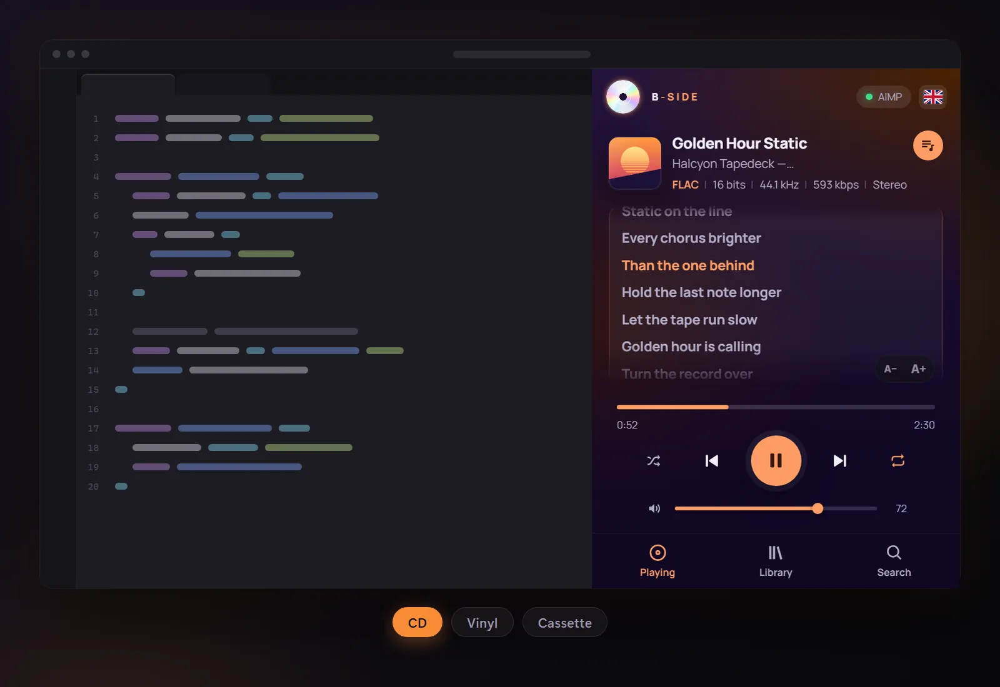

<p align="center">
  <a href="README.md">English</a> &nbsp;·&nbsp; <a href="README.es.md">Español</a> &nbsp;·&nbsp; <b>Deutsch</b> &nbsp;·&nbsp; <a href="README.ja.md">日本語</a> &nbsp;·&nbsp; <a href="README.zh.md">中文</a> &nbsp;·&nbsp; <a href="README.ru.md">Русский</a>
</p>

<h1 align="center"><br>B-Side</h1>

<p align="center"><b>Deine Musiksammlung in Orcas Seitenleiste.</b><br>
Stöbere, suche und spiele die Musik auf deinem Windows-PC, mit synchronisierten Songtexten und drei Skins. Abgespielt mit AIMP, einem kostenlosen Player.</p>

<p align="center">
  
</p>

<p align="center">
  <a href="https://github.com/icaceresc/b-side/actions/workflows/ci.yml"></a>
  
  <a href="LICENSE"></a>
</p>

### Deine ganze Sammlung, einen Tastendruck entfernt

Interpreten, Alben, Titel und Genres aus deinen eigenen Ordnern, mit Covern und dem aus jeder
Datei gelesenen Format (FLAC · 24 Bit · 96 kHz). Drück `/` oder `Strg+K` und tippe: `rio` findet *Río*.

<p align="center"></p>

### Songtexte, die dem Lied folgen

Synchronisierte Songtexte leuchten Zeile für Zeile auf; A− und A+ ändern ihre Größe. Sie kommen
aus den Tags deiner Dateien oder aus einer `.lrc` neben dem Titel.

<p align="center"></p>

### Drei Skins und ein Logo, das mitspielt

CD trägt die Farben jedes Covers, Vinyl ist Leder und Altgold, Kassette ein Tapedeck der 80er in
Pixeln. Drück aufs Logo, um einen zu wählen; es dreht sich, solange Musik läuft, und hält bei Pause an.

<p align="center"></p>

### Lokal und privat

B-Side liest nur deine Musikordner und verändert nie deine Dateien. Kein Konto, kein Tracking: mit
Musik auf deinem PC nutzt es das Netzwerk nur, um einmal seinen eigenen Helfer (0,5 MB) von GitHub
zu laden, per SHA-256 geprüft, und das lässt sich abschalten.
[Was es liest, schreibt und herunterlädt](docs/guide.de.md#privacy).

## Installation

In einem Terminal in Orca:

```powershell
orca plugin install icaceresc/b-side
```

Orca zeigt, was B-Side darf, und gibt denselben Befehl mit `--approve <Code>` aus: führe ihn aus.
Öffne dann **B-Side** in der rechten Seitenleiste und wähle deine Musikordner.

**Voraussetzungen:** Windows 10 oder 11, [Orca](https://github.com/stablyai/orca) 1.4.248 oder
neuer und [AIMP aus dem Microsoft Store](https://apps.microsoft.com/detail/9PCLLLH15SMT) (kostenlos). Noch kein AIMP? `install.ps1` richtet
es für dich ein: [Installation im Detail](docs/guide.de.md#install).

## Mehr erfahren

[Ordner wählen](docs/guide.de.md#library-folders) ·
[Alles, was es kann](docs/guide.de.md#features) ·
[Problemlösung](docs/guide.de.md#troubleshooting) ·
[Datenschutz](docs/guide.de.md#privacy) ·
[Aktualisieren](docs/guide.de.md#update) ·
[Streaming aus der Cloud (Beta)](docs/guide.de.md#two-ways-to-use-it) ·
[So funktioniert es](docs/guide.de.md#how-it-works) ·
[Den Helfer prüfen](docs/guide.de.md#verify-helper) ·
[Entwickeln](docs/guide.de.md#develop)

---

<sub>[MIT](LICENSE). Ein unabhängiges Projekt, weder mit AIMP noch mit Orca verbunden. Die Bilder und die Demo-Musik
sind für B-Side gemacht: erfundene Interpreten, originale synthetische Musik und generierte Cover. [Danksagung](docs/guide.de.md#credits).</sub>
