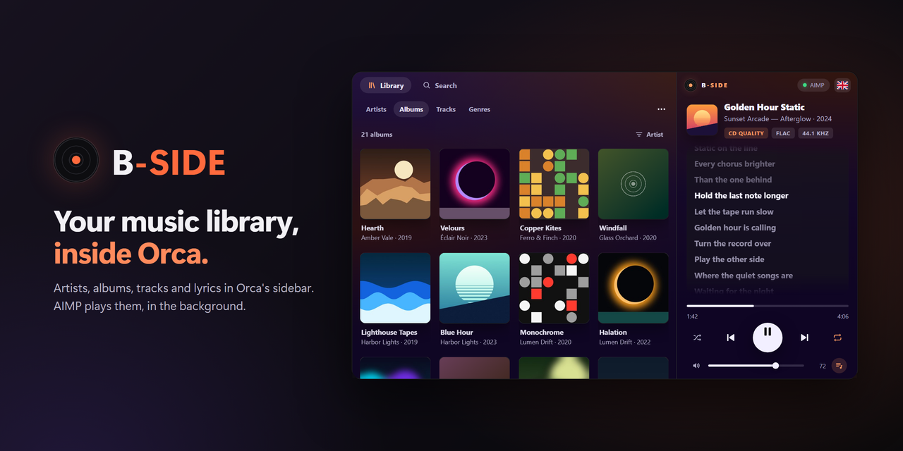
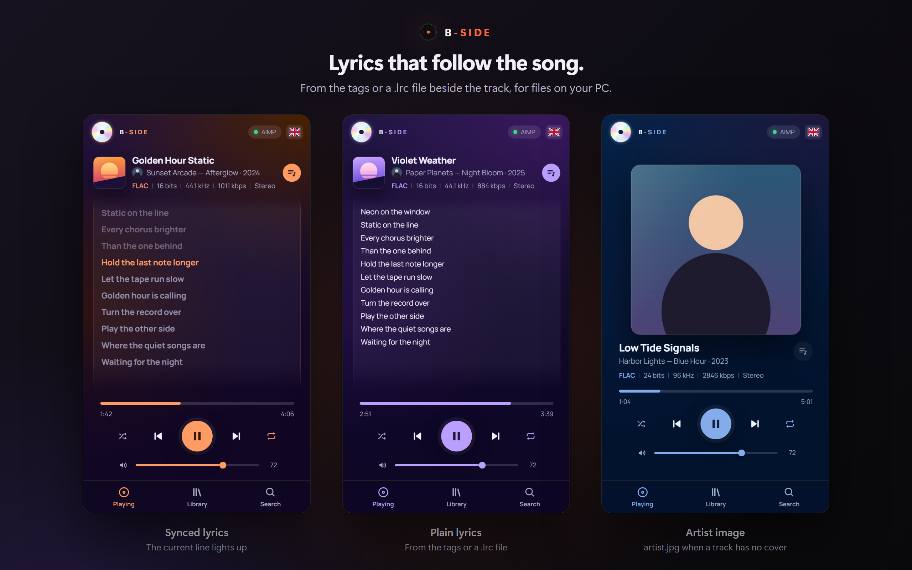

<p align="center">
  <a href="README.md"></a>&nbsp;<a href="README.md">English</a> &nbsp;·&nbsp;
  <a href="README.es.md"></a>&nbsp;<a href="README.es.md">Español</a> &nbsp;·&nbsp;
  <a href="README.de.md"></a>&nbsp;<a href="README.de.md"><b>Deutsch</b></a> &nbsp;·&nbsp;
  <a href="README.ja.md"></a>&nbsp;<a href="README.ja.md">日本語</a> &nbsp;·&nbsp;
  <a href="README.zh.md"></a>&nbsp;<a href="README.zh.md">中文</a> &nbsp;·&nbsp;
  <a href="README.ru.md"></a>&nbsp;<a href="README.ru.md">Русский</a>
</p>

<p align="center">
  
</p>

<p align="center">
  <a href="https://github.com/icaceresc/b-side/actions/workflows/ci.yml"></a>
  
  
  
  
  
</p>

# B-Side

Eine Musik-App für deine eigene Sammlung, in Orcas Seitenleiste. B-Side indiziert die Musikordner,
die du wählst, lässt dich nach Interpret, Album, Titel und Genre stöbern, findet alles schon beim
Tippen und spielt es über [AIMP](https://www.aimp.ru) ab, das als Engine im Hintergrund bleibt.
Deine verlustfreien Dateien, ihre Cover und Songtexte, ohne den Editor zu verlassen.

## Was du bekommst

<table>
  <tr>
    <td align="center" width="50%"></td>
    <td align="center" width="50%"></td>
  </tr>
  <tr>
    <td align="center"><sub>Mediathek</sub></td>
    <td align="center"><sub>Album</sub></td>
  </tr>
  <tr>
    <td align="center"></td>
    <td align="center"></td>
  </tr>
  <tr>
    <td align="center"><sub>Läuft</sub></td>
    <td align="center"><sub>Suche</sub></td>
  </tr>
</table>

- **Mediathek**: Interpreten, Alben, Titel und Genres aus den Tags deiner Dateien; fehlt ein Tag,
  springen Ordner- und Dateinamen ein (`Interpret\Album\01 Titel.flac`). Alben lassen sich nach
  Interpret, Titel oder Jahr sortieren; die Titelliste scrollt auch mit zehntausend Titeln flüssig.
- **Interpreten- und Albumseiten**: eingefärbt nach dem Albumcover oder dem Künstlerbild. Eine
  Albumseite zeigt das aus den Dateien gelesene Format (Codec, Abtastrate, Bittiefe, *Verlustfrei*,
  *Hi-Res*), ihre Discs und Laufzeiten und markiert Titel mit Songtext oder nur in der Cloud.
- **Abspielen**: ein Album von seiner Seite, die Alben eines Interpreten von dessen Seite, oder
  tippe auf einen Titel, um ab dort bis zum Ende seines Albums zu spielen. Das Menü eines Titels oder
  Albums (**⋯**) bietet **Als Nächstes spielen**, **Zur Warteschlange**, **Zum Album** und
  **Zum Interpreten**. Ist AIMP geschlossen, startet es beim Abspielen.
- **Suche**: sofort, über Interpreten, Alben und Titel. Groß- und Kleinschreibung sowie Akzente
  zählen nicht (`rosalia` findet *Rosalía*), und Wörter in japanischen oder chinesischen Namen werden
  gefunden. `/` oder `Strg+K` bringt dich von überall im Panel dorthin.
- **Läuft**: Cover, Titel, Interpret und Album (jedes öffnet seine Seite in der Mediathek), das echte
  Format, wie AIMP es meldet, mit einem *CD-Qualität*-Abzeichen für verlustfreies 44,1 kHz Stereo,
  und jede Steuerung: Wiedergabe/Pause, zurück, weiter, Spulen (Leiste ziehen oder ←/→), Lautstärke,
  Stummschalten, Zufall und Wiederholen. `Leertaste` startet oder pausiert.
- **Songtexte**: aus den Tags der Datei (FLAC `LYRICS`/`UNSYNCEDLYRICS`, MP3 `USLT`/`SYLT`) oder
  einer `.lrc` neben dem Titel, sichtbar unter Läuft, sobald der Titel einen hat. Synchronisierte
  Songtexte folgen dem Lied; tippe auf eine Zeile, um dorthin zu springen. Hat ein Titel keinen,
  sagt der Knopf **Songtext**, warum.
- **Für die Seitenleiste gemacht**: schmal funktioniert es wie eine Handy-App, mit den Reitern Läuft,
  Mediathek und Suche und einem Mini-Player; ziehst du die Seitenleiste breiter, stehen Mediathek
  oder Suche links und Läuft rechts.
- **Cover-Farben**: Hintergrund und Akzent kommen aus der Palette des Covers, der Text bleibt in
  Hell und Dunkel lesbar.
- **Klare Zustände**: Ordner wählen, Einlesen, AIMP geschlossen (mit einem Knopf *AIMP öffnen*), AIMP
  reagiert nicht, offline.
- **Deine Sprache**: English, Español, Deutsch, 日本語, 中文 oder Русский, über die Flagge in der Ecke.
  Es startet in Orcas Sprache und merkt sich deine Wahl; helles und dunkles Design folgen Orca.

<p align="center"></p>
<p align="center"></p>

*Die Screenshots zeigen eine synthetische Demo-Mediathek mit Demo-Covern.*

## Voraussetzungen

- Windows 10 oder 11
- [Git](https://git-scm.com/download/win)
- [Orca](https://github.com/stablyai/orca) 1.4.248 oder neuer
- AIMP aus dem Microsoft Store (das Installationsskript holt es für dich, pro Benutzer, ohne Adminrechte)

## Installation

Zwei Schritte, beide in einem Terminal in Orca (dort gibt es den Befehl `orca`).

**1. Plugin installieren.**

```powershell
orca plugin install icaceresc/b-side
```

B-Side führt Code auf deinem PC aus: einen kleinen Worker, den Orca startet, um deine Mediathek zu
lesen und mit AIMP zu sprechen (ein *Trusted Worker*). Deshalb hält Orca beim ersten Mal an, zeigt,
was das Plugin bekäme (seinen eigenen Speicher und seine eigenen Einstellungen, sonst nichts), und
gibt denselben Befehl mit `--approve <Code>` am Ende aus. Führe diesen Befehl aus, um es
freizugeben und zu installieren.

**2. AIMP vorbereiten.**

```powershell
git clone https://github.com/icaceresc/b-side.git
cd b-side
powershell -ExecutionPolicy Bypass -File .\install.ps1
```

`-ExecutionPolicy Bypass` gilt nur für diesen einen Aufruf, weil Windows Skripte standardmäßig
blockiert. `install.ps1` installiert AIMP, falls es fehlt, behebt einen Einstellungsfehler der
Store-Version und schaltet Streaming in My Clouds ein. Schritt 1 erledigt es gleich mit: Es
installiert oder aktualisiert das Plugin von GitHub und zeigt den Freigabebefehl an, wenn Orca
danach fragt; auf einem neuen PC reicht also dieses eine Skript. Es lässt sich gefahrlos erneut
ausführen. Optionen:

- `-SkipSettings`: AIMP installieren und den Einstellungsfehler beheben, AIMPs Einstellungen aber nicht anfassen.
- `-SkipPlugin`: nur AIMP vorbereiten, das Plugin nicht installieren.

Danach öffnest du **B-Side** in Orcas rechter Seitenleiste und wählst deine Musikordner.

<a id="library-folders"></a>

## Musikordner wählen

Beim ersten Mal fragt das Panel, wo deine Musik liegt. Es schlägt die Ordner mit Musik auf diesem
PC vor: den Windows-Ordner Musik und den Musikordner jedes OneDrive (*Music*, *Música*, *Musik*,
*音楽*…), jeweils mit ihren großen Unterordnern und der Zahl ihrer Titel. Wähle einen oder mehrere,
oder füge den Pfad eines anderen Ordners ein, und klicke auf **Diese Ordner verwenden**. B-Side liest
bis zu 16 Ordner.

Ändern kannst du sie jederzeit, im Panel (**Ordner ändern** in den Optionen der Mediathek) oder in
Orca unter **Settings › Plugins › B-Side › Library folders**, ein Ordner pro Zeile. Bleibt diese
Einstellung leer, nimmt B-Side den Windows-Ordner Musik.

Das Indizieren läuft im Hintergrund, du kannst währenddessen stöbern. Bei einer Sammlung aus 428
FLAC-Dateien dauerte das erste Einlesen etwa 2 Sekunden; danach öffnet das Panel sofort mit dem
gespeicherten Index, und spätere Durchläufe lesen nur geänderte Dateien neu.

## Aktualisieren

```powershell
orca plugin update icaceresc.b-side
```

Orca fragt nur dann erneut nach einer Freigabe, wenn eine neue Version mehr Zugriff verlangt.
**B-Side 2.0 tut das einmal, beim Update von 1.2.x**: Es bekommt eigene Einstellungen
(`settings:own`) für die Musikordner. Orca listet diese Änderung auf und gibt denselben Befehl mit
`--approve <Code>` aus; führe ihn aus. Bis zur Freigabe läuft deine bisherige Version weiter. Für
das neueste `install.ps1` führe `git pull` im Klon aus; ein erneuter Lauf des Skripts
aktualisiert auch das Plugin.

<a id="aimp-setting"></a>

## So spielt B-Side in AIMP

AIMPs Remote API kann die Wiedergabe steuern, aber keine Dateien laden; deshalb übergibt B-Side
Titel an AIMP wie der Explorer. Spielst du ein Album oder einen Titel ab, bittet B-Side AIMP, den
ersten Titel zu öffnen; AIMP leert seine Wiedergabeliste **Default**, fügt den Titel hinzu und spielt
ihn. Danach hängt B-Side den Rest des Albums an. **Zur Warteschlange** fügt Titel ans Ende der
Wiedergabeliste an, die AIMP gerade spielt, und **Als Nächstes spielen** setzt sie direkt hinter den
laufenden Titel (ans Ende, wenn AIMP eine eigene Wiedergabeliste spielt). Läuft nichts, spielen
beide die Titel ab.

Das hängt an einer AIMP-Einstellung, die B-Side nie ändert: **Systemeinstellungen ›
Wiedergabeliste › Datei hinzufügen › Öffne Datei(en) von anderen Anwendungen › Standardaktion**, auf
AIMPs Standardwert **zur leeren Wiedergabeliste "Default" hinzufügen** (englisch: *Preferences ›
Playlist › File adding › Open files from external applications › Default action: Add to empty
playlist "Default"*). Mit einer anderen Wahl spielt AIMP den Titel trotzdem, aber jedes Mal in einem
neuen Wiedergabelisten-Tab (*neue Wiedergabeliste erstellen*) oder angehängt an die schon offene
Liste (*zur aktuellen Wiedergabeliste hinzufügen*), und der Rest des Albums landet am Ende dieser
Liste.

Zurück erreicht keine früheren Titel des Albums: In die Warteschlange kommen nur der gewählte Titel
und die danach.

<a id="two-ways-to-use-it"></a>

## Zwei Arten, es zu nutzen

**Privater PC: alles lokal.** Leg deine Musik in Ordner auf diesem PC (oder in OneDrive, auf
*Immer auf diesem Gerät beibehalten* gestellt). Dateien auf deiner Festplatte bekommen alles: Tags,
Cover, Songtexte und Künstlerbilder. Mit dieser Ordnerstruktur findet B-Side, was es sucht:

```text
Musik\
  Interpret\
    artist.jpg            das Künstlerbild
    Album\
      cover.jpg           das Albumcover, wenn es nicht in den Tags der Dateien steckt
      01 Titel.flac
      01 Titel.lrc        Songtext, nur wenn er nicht in den Tags der Datei steht
```

**Arbeits-PC: nur Streaming.** Richte B-Side auf deinen OneDrive-Musikordner mit OneDrives
*Dateien bei Bedarf*, so bleibt die Sammlung in der Cloud. Dateien, die nur in der Cloud liegen,
werden anhand ihrer Ordner- und Dateinamen aufgelistet; B-Side öffnet oder liest sie nie, denn das
würde sie herunterladen. Ihre Cover und Songtexte erscheinen nur, wenn diese Dateien (`cover.jpg`,
eine `.lrc`) schon auf dem PC sind. Spielst du einen Titel ab, öffnet AIMP ihn und OneDrive lädt ihn
herunter; danach behält OneDrive die Datei auf dem PC, wie jede Datei, die du öffnest, bis du im
Explorer **Speicherplatz freigeben** für sie wählst. Das Panel markiert Titel und Alben, die nur in
OneDrive liegen.

<a id="my-clouds"></a>

## Aus My Clouds streamen (optional)

AIMP kann auch über das eingebaute **My Clouds** aus OneDrive, Google Drive, Dropbox und mehr
streamen, ohne Dateien auf diesen PC zu kopieren. Diese Titel sind nicht in B-Sides Mediathek: Du
wählst sie in AIMP, und B-Sides Reiter Läuft zeigt und steuert sie (Cover, Angaben und Cover-Farben;
Songtext und Künstlerbild brauchen Dateien auf dem PC).

1. Klicke im B-Side-Panel auf **AIMP öffnen**.
2. Öffne in AIMP den Reiter **My Clouds**, klicke links mit der rechten Maustaste auf **All** und
   wähle **Add Storage...** (My Clouds hat keine deutsche Übersetzung, die Menüs sind englisch).
3. Dienst: **OneDrive** (oder ein anderer) › **Get Token** › anmelden › Zugriff erlauben › **OK**.
   Auf einem PC mit Arbeits- oder Schulkonto lies zuerst [Arbeits- oder Schul-PC](#work-account).
4. Wähle ein Album und starte die Wiedergabe.

Das Installationsskript schaltet den Streaming-Zugriff ein, Titel werden also nicht komplett
heruntergeladen: AIMP puffert nur, was gerade läuft, und leert seinen Cache beim Beenden.

<a id="work-account"></a>

> **⚠ Arbeits- oder Schul-PC: Melde My Clouds mit deinem privaten Konto an.**
>
> Ist Windows mit einem Arbeits- oder Schulkonto angemeldet, kann die Microsoft-Anmeldeseite, die
> **Get Token** öffnet, dieses Konto von selbst wählen; My Clouds würde dann aus deinem
> Arbeits-OneDrive streamen. Wähle in AIMP › **My Clouds** › **Add Storage...** › **OneDrive** ›
> **Get Token** die Option **Anderes Konto verwenden** und melde dich mit deinem privaten
> Microsoft-Konto an; fragt Microsoft nach der Kontoart, wähle **Persönliches Konto**. Das Skript
> warnt dich, wenn Windows ein Arbeits- oder Schulkonto hat.
>
> - **Prüfen**: Öffne den Speicher in My Clouds. Du solltest die Ordner deines privaten OneDrive
>   sehen (deine Musik). Arbeitsdateien oder ein leeres, unbekanntes OneDrive bedeuten das
>   Arbeitskonto.
> - **Beheben**: Rechtsklick auf den Speicher › **Edit Storage...** › **Get Token** und erneut mit
>   deinem privaten Konto anmelden. Oder Rechtsklick › **Remove Storage...** (**Delete local cache**
>   anhaken, um auch die zwischengespeicherten Dateien zu löschen) und neu hinzufügen.

## Klangqualität

B-Side fasst das Audio nie an: AIMP dekodiert und spielt es ab. Das Installationsskript schaltet
AIMPs Effekte ab (Überblendungen, Normalisierung, Anti-Clipping, Dithering); den Enhancer verwaltet AIMP
selbst, prüfe ihn im Fenster der Klangeffekte. Damit
Dateien in CD-Qualität ohne Resampling bei deinen Kopfhörern ankommen, stellst du das
Windows-Format des Geräts auf dieselbe Rate: **Einstellungen › System › Sound › dein Gerät ›
Ausgabeeinstellungen › Format: 16 Bit, 44100 Hz**. Andere Töne laufen weiter neben der Musik.

Willst du das Gerät exklusiv? In AIMP unter **Preferences › Playback › Device** den Eintrag
*WASAPI Exclusive* wählen. Benachrichtigungen und Anrufe auf diesem Gerät sind dann stumm,
solange AIMP spielt.

## So funktioniert es

```text
Orca-Panel ──plugin.request──▶ B-Side-Worker (Node) ──stdin/stdout──▶ Helfer (PowerShell + C#) ──▶ AIMP
Läuft · Mediathek · Suche      Mediathek-Index, Tags,                 Remote API: Zustand, Steuerung, Cover
                               Suche, Warteschlange                   Shell-Verben: öffnen, zur Liste hinzufügen
                                     │                                Ordnerliste, Vorschaubilder
                                     ▼
                        %LOCALAPPDATA%\B-Side\cache
                        library.json · Vorschaubilder · kompilierter Helfer
```

- **Mediathek**: Der Helfer listet deine Ordner nur aus dem Verzeichnis (Namen, Größen, Daten und
  Windows-Attribute), das Auflisten öffnet also keine Datei. Der Worker liest die Tags lokaler
  Dateien, nur lesend, baut daraus Interpreten, Alben, Titel und Genres und speichert den Index in
  `%LOCALAPPDATA%\B-Side\cache\library.json`; Cover und Künstlerbilder werden daneben zu kleinen
  Vorschaubildern. Nach einem Neustart antwortet Orca sofort aus dem gespeicherten Index und
  frischt ihn im Hintergrund auf. Das Panel bekommt Namen und undurchsichtige IDs, nie Dateipfade.
- **Wiedergabe**: Der Helfer öffnet einen Titel über AIMPs eigene Dateizuordnungen, wie der
  Explorer (*öffnen*, und AIMPs *Zur Wiedergabeliste hinzufügen* für den Rest des Albums, aus einer
  kurzen `.m3u8`-Liste in `%LOCALAPPDATA%\B-Side\queue`, die B-Side nach 10 Minuten löscht). Alles
  andere (Zustand, Wiedergabe/Pause, Spulen, Lautstärke, das Cover) läuft über AIMPs offizielle
  Remote API: Fensternachrichten und den gemeinsamen Speicher `AIMP2_RemoteInfo`. Jeder Befehl
  steht auf einer Erlaubnisliste.
- **Der Helfer** kompiliert seinen kleinen C#-Teil einmal und legt das Ergebnis im Cache-Ordner ab,
  damit spätere Starts schnell sind; ein geänderter Helfer wird neu kompiliert.
- Orca führt den Worker als *Trusted Worker* aus: einen Node-Prozess mit den Rechten deines
  Benutzerkontos auf diesem PC; deshalb bittet Orca dich um Freigabe. Von Orcas eigenen
  Berechtigungen verlangt das Plugin nur seinen eigenen Speicher (deine Sprache und wo du das Panel
  verlassen hast) und seine eigenen Einstellungen (die Musikordner): kein Terminal, keine
  Arbeitsbereiche oder Geheimnisse.

## Datenschutz

- Liest, nur lesend, die Ordner, die du wählst: ihre Dateiliste und die Tags, eingebetteten Cover,
  Songtexte und Bilder der Dateien, die auf dem PC liegen. Dateien, die nur in der Cloud liegen,
  werden nie geöffnet. Außerdem liest es, was AIMP über den laufenden Titel meldet: Titel,
  Interpret, Album, Jahr, Format und Cover.
- Schreibt, verschiebt oder löscht nie deine Musikdateien. Es schreibt nur in
  `%LOCALAPPDATA%\B-Side` (Index, Vorschaubilder, kompilierter Helfer und Warteschlange) und in
  seinen eigenen Orca-Speicher und seine Einstellungen. Ordnerpfade bleiben auf diesem PC; gesendet
  wird nichts.
- Berührt nie dein Cloud-Konto oder dessen Anmeldung. OneDrive und My Clouds melden sich selbst an.
- Nutzt das Netzwerk nur hierfür: Solange das Panel sichtbar ist, prüft es alle 30 s die
  Verbindung, indem es eine TCP-Verbindung zu `graph.microsoft.com:443` öffnet (und schließt), ohne
  etwas zu senden. Es lauscht an keinem Port.

## Einschränkungen

- Gebaut und getestet für AIMP 4.60 aus dem Microsoft Store. AIMP 5 installiert sich für den
  ganzen Rechner (Adminrechte).
- Das Abspielen setzt voraus, dass AIMPs **Standardaktion** für Dateien aus anderen Anwendungen auf
  ihrem Standardwert steht ([So spielt B-Side in AIMP](#aimp-setting)).
- Zurück erreicht nicht die Albumtitel vor dem gewählten. **Als Nächstes spielen** startet den
  laufenden Titel an derselben Stelle neu, mit einer kurzen Lücke, weil AIMP Titel nur am Ende
  anfügen kann.
- B-Side zeigt AIMPs Wiedergabeliste nicht. Unter Läuft ist das Format das, was AIMP meldet, ohne
  Bittiefe; Albumseiten zeigen die Bittiefe aus den Tags der Dateien.
- Aus My Clouds gestreamte Titel sind nicht in der Mediathek und zeigen weder Songtext noch
  Künstlerbild.
- Bis zu 16 Musikordner. Nur der lokale Orca-Host.
- Auf einem PC mit Arbeits- oder Schulkonto kann sich My Clouds mit diesem Konto anmelden: siehe [Arbeits- oder Schul-PC](#work-account).

## Wiederherstellen und deinstallieren

- **Die Mediathek ist leer oder veraltet**: Prüfe die Ordner (**Ordner ändern**, oder in Orca
  **Settings › Plugins › B-Side › Library folders**) und klicke auf **Erneut einlesen**.
- **Jeder abgespielte Titel öffnet in AIMP einen neuen Wiedergabelisten-Tab**: Stell AIMPs
  **Standardaktion** zurück auf **zur leeren Wiedergabeliste "Default" hinzufügen**
  ([So spielt B-Side in AIMP](#aimp-setting)).
- **AIMP vergisst nach dem Beenden seine Einstellungen**: im Klon `powershell -ExecutionPolicy Bypass -File .\install.ps1 -SkipSettings -SkipPlugin` ausführen.
- **Das Panel meldet AIMP als geschlossen, obwohl es offen ist**: AIMP neu starten; das Panel
  verbindet sich von selbst.
- **Änderungen des Skripts an AIMP rückgängig machen**: AIMPs ursprüngliche Einstellungen liegen
  daneben als `AIMP.ini.b-side.bak`.
- **Deinstallieren**: `orca plugin uninstall icaceresc.b-side` (oder `orca plugin dev unload <Pfad>\b-side`,
  wenn du es mit `-Dev` geladen hast), danach AIMP bei Bedarf über Windows-Einstellungen › Apps
  entfernen und den Klon löschen. Um auch den Index zu entfernen, lösche `%LOCALAPPDATA%\B-Side`.

## Entwickeln

Alles läuft vom Stammverzeichnis des Repositorys aus:

```powershell
orca plugin test .        # Unit-Tests (node:test)
orca plugin validate .
orca plugin dev watch . --check --shot .orca/shots
powershell -ExecutionPolicy Bypass -File .\install.ps1 -Dev    # diesen Ordner statt der GitHub-Version laden
```

`native/aimp-helper.ps1` ist der einzige Code, der AIMP berührt; der Worker startet ihn mit einem
kleinen Lader, der an `powershell.exe -EncodedCommand` geht und das Skript liest, und spricht über
stdin/stdout mit ihm. Die Mediathek liegt in `src/library/`, die Wiedergabe in `src/playback.mjs`
und das Panel in `panel/`. GitHub Actions führt den CI-Workflow (Abzeichen oben) unter Windows aus.

Icon, Titelbild und Screenshots für Orcas Plugin-Seite entstehen mit `python docs/make-assets.py`
(Pillow, dazu Chrome oder Edge): Es zeichnet das echte Panel mit einer synthetischen
Demo-Mediathek; führe es erneut aus, wenn sich das Panel ändert.

## Danksagung und Lizenz

- B-Side: [MIT-Lizenz](LICENSE).
- [AIMP](https://www.aimp.ru) von Artem Izmaylov und My Clouds sind eigenständige Produkte und
  nicht enthalten. Dies ist ein unabhängiges Projekt, kein offizielles AIMP- oder Orca-Projekt.
- Flaggen-Icons: [lipis/flag-icons](https://github.com/lipis/flag-icons), [MIT-Lizenz](panel/flags/LICENSE).
