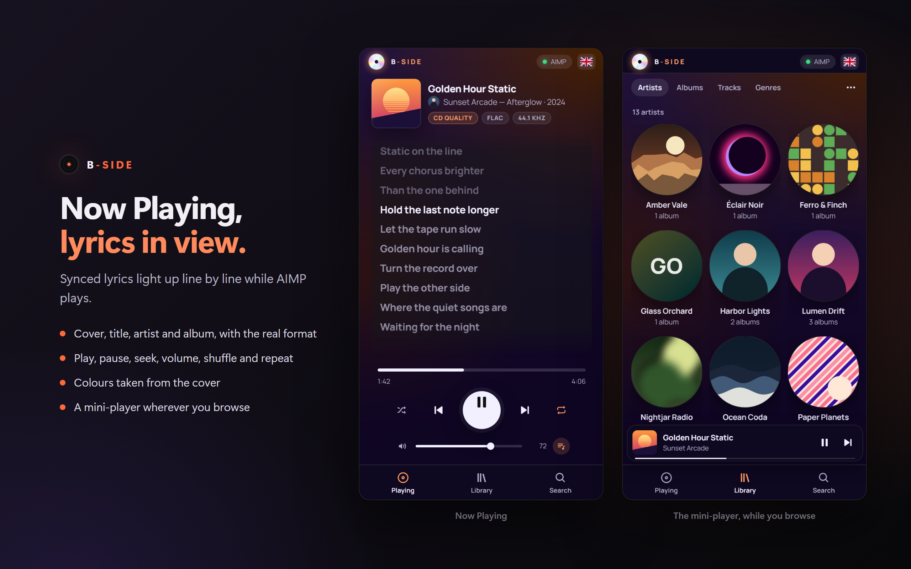
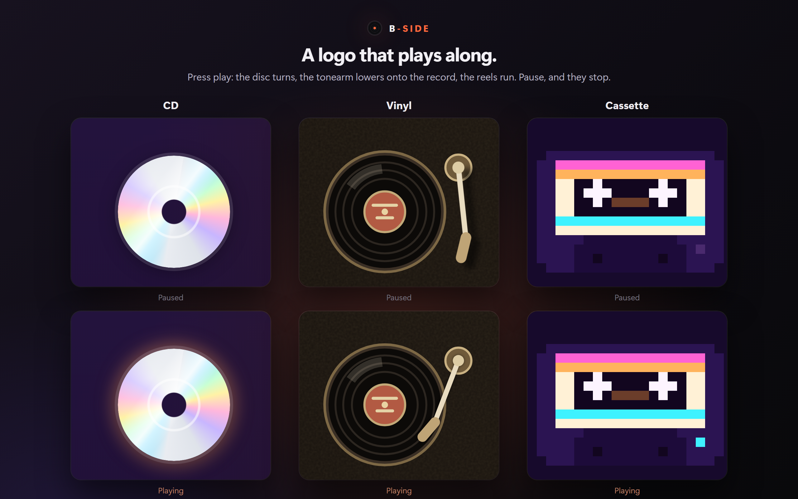
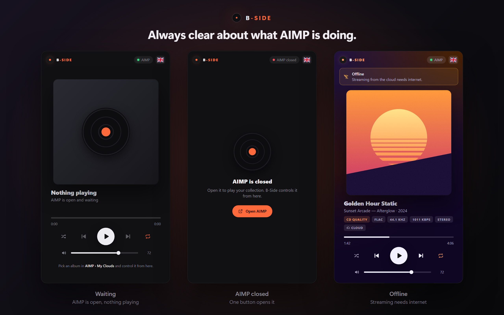

<p align="center">
  <a href="README.md"></a>&nbsp;<a href="README.md">English</a> &nbsp;·&nbsp;
  <a href="README.es.md"></a>&nbsp;<a href="README.es.md"><b>Español</b></a> &nbsp;·&nbsp;
  <a href="README.de.md"></a>&nbsp;<a href="README.de.md">Deutsch</a> &nbsp;·&nbsp;
  <a href="README.ja.md"></a>&nbsp;<a href="README.ja.md">日本語</a> &nbsp;·&nbsp;
  <a href="README.zh.md"></a>&nbsp;<a href="README.zh.md">中文</a> &nbsp;·&nbsp;
  <a href="README.ru.md"></a>&nbsp;<a href="README.ru.md">Русский</a>
</p>

<p align="center">
  
</p>

<p align="center">
  <a href="https://github.com/icaceresc/b-side/actions/workflows/ci.yml"></a>
  
  
  
  
  
</p>

# B-Side

Una app de música para tu propia colección, en la barra lateral de Orca. B-Side indexa las
carpetas de música que elijas, te deja recorrerlas por artista, álbum, canción y género, encuentra
lo que buscas mientras escribes y lo reproduce con [AIMP](https://www.aimp.ru), que se queda en
segundo plano como motor. Tus archivos lossless, sus portadas y sus letras, sin salir del editor.

## Qué obtienes

<table>
  <tr>
    <td align="center" width="50%"></td>
    <td align="center" width="50%"></td>
  </tr>
  <tr>
    <td align="center"><sub>Biblioteca</sub></td>
    <td align="center"><sub>Álbum</sub></td>
  </tr>
  <tr>
    <td align="center"></td>
    <td align="center"></td>
  </tr>
  <tr>
    <td align="center"><sub>Sonando</sub></td>
    <td align="center"><sub>Buscar</sub></td>
  </tr>
</table>

- **Biblioteca**: Artistas, Álbumes, Canciones y Géneros, a partir de las etiquetas de tus
  archivos; cuando falta una etiqueta, usa los nombres de carpeta y de archivo
  (`Artista\Álbum\01 Título.flac`). Los álbumes se ordenan por artista, título o año; la lista de
  Canciones se desplaza con fluidez aunque tenga diez mil.
- **Páginas de artista y de álbum**: teñidas con la portada del álbum o la foto del artista. La
  página de un álbum muestra el formato leído de sus archivos (códec, frecuencia de muestreo,
  profundidad de bits, *Sin pérdida*, *Hi-Res*), sus discos y duraciones, y marca las canciones que
  tienen letra o que solo están en la nube.
- **Reproducir**: reproduce un álbum desde su página, los álbumes de un artista desde la página del
  artista, o pulsa una canción para reproducir desde ella hasta el final de su álbum. El menú de una
  canción o de un álbum (**⋯**) tiene **Reproducir a continuación**, **Agregar a la cola**,
  **Ir al álbum** e **Ir al artista**. Si AIMP está cerrado, al reproducir se abre.
- **Buscar**: al instante, en artistas, álbumes y canciones. No distingue mayúsculas ni acentos
  (`rosalia` encuentra *Rosalía*) y encuentra palabras dentro de nombres en japonés o chino. `/` o
  `Ctrl+K` te llevan ahí desde cualquier parte del panel.
- **Sonando**: portada, título, artista y álbum (cada uno abre su página en la biblioteca), el
  formato en una línea (`FLAC | 16 bits | 44.1 kHz | 738 kbps | Estéreo`) y
  todos los controles: reproducir/pausar, anterior, siguiente, avanzar en la canción (arrastra la
  barra o usa ←/→), volumen, silencio, aleatorio y repetir. `Espacio` pausa o reanuda.
- **Letras**: desde las etiquetas del archivo (FLAC `LYRICS`/`UNSYNCEDLYRICS`, MP3 `USLT`/`SYLT`) o
  un `.lrc` junto a la canción, visibles en Sonando siempre que la canción las tenga. Las letras
  sincronizadas siguen la canción; pulsa una línea para saltar ahí. Cuando una canción no tiene
  letra, el botón **Letra** te dice por qué.
- **Hecho para la barra lateral**: angosto, funciona como una app de teléfono, con las pestañas
  Sonando, Biblioteca y Buscar y un minirreproductor; si ensanchas la barra lateral, la biblioteca o
  la búsqueda quedan a la izquierda y Sonando a la derecha.
- **Colores de la portada**: el fondo y el color de acento salen de la paleta de la portada, con el
  texto siempre legible en claro y oscuro.
- **Estados claros**: elegir tus carpetas, leyendo la biblioteca, AIMP cerrado (con un botón
  *Abrir AIMP*), AIMP sin responder, sin conexión.
- **Tu idioma**: English, Español, Deutsch, 日本語, 中文 o Русский, desde la bandera de la esquina.
  Empieza en el idioma de Orca y recuerda tu elección; los temas claro y oscuro siguen a Orca.

<a id="skins"></a>

### Aspectos

<p align="center"></p>

Toca el logo de arriba a la izquierda y elige un aspecto; B-Side lo recuerda. Cada uno cambia todo el panel (Sonando, Biblioteca, Buscar, letras, el minirreproductor y la línea del formato) en los temas claro y oscuro de Orca, con texto que mantiene el contraste WCAG AA.

- **CD** (el predeterminado): el B-Side de hoy, refinado. Tipografía Manrope, barras de vidrio y los colores de la portada que suena.
- **Vinilo**: una sala de escucha en latón, nogal y marfil. Cormorant y EB Garamond, versalitas, filetes dorados y la portada enmarcada como un grabado.
- **Casete**: vaporwave de 8 bits. Tipografía pixelada (Pixelify Sans y Press Start 2P), neón sobre violeta, sombras pixeladas y una barra de progreso de LED.

<p align="center"></p>

El logo acompaña a AIMP: el CD gira, iridiscente, bajo un brillo fijo; el disco gira a 33⅓ y el brazo baja sobre él, y se levanta al pausar; los carretes del casete corren. Las animaciones solo corren mientras suena música y el panel está a la vista, y se detienen con los *Efectos de animación* de Windows desactivados (el logo igual muestra que suena con un brillo, una luz o el brazo sobre el disco).

<p align="center"></p>
<p align="center"></p>

*Las capturas usan una biblioteca y portadas de demostración sintéticas.*

## Requisitos

- Windows 10 u 11
- [Git](https://git-scm.com/download/win)
- [Orca](https://github.com/stablyai/orca) 1.4.248 o posterior
- AIMP de Microsoft Store (el instalador lo consigue por ti, por usuario y sin administrador)

## Instalación

Son dos pasos, los dos en una terminal dentro de Orca (ahí está el comando `orca`).

**1. Instala el plugin.**

```powershell
orca plugin install icaceresc/b-side
```

B-Side ejecuta código en tu PC: un pequeño worker que Orca inicia para leer tu biblioteca y hablar
con AIMP (un *trusted worker*). Por eso, la primera vez Orca se detiene, te muestra lo que recibiría
el plugin (su propio almacenamiento y su propia configuración, nada más) e imprime el mismo comando
con `--approve <código>` al final. Ejecuta ese comando para aprobarlo e instalarlo.

**2. Prepara AIMP.**

```powershell
git clone https://github.com/icaceresc/b-side.git
cd b-side
powershell -ExecutionPolicy Bypass -File .\install.ps1
```

`-ExecutionPolicy Bypass` solo vale para esta ejecución, porque Windows bloquea los scripts por
defecto. `install.ps1` instala AIMP si falta, corrige un error de configuración de la edición de
la Store y activa el streaming en My Clouds. También hace el paso 1 por ti: instala o actualiza el
plugin desde GitHub y muestra el comando de aprobación cuando Orca lo pide, así que en una PC nueva
basta con este script. Puedes volver a ejecutarlo sin riesgo. Opciones:

- `-SkipSettings`: instala AIMP y corrige el error de configuración, pero no toca los ajustes de AIMP.
- `-SkipPlugin`: solo prepara AIMP; no instala el plugin.

Luego abre **B-Side** en la barra lateral derecha de Orca y elige tus carpetas de música.

<a id="library-folders"></a>

## Elige tus carpetas de música

La primera vez, el panel te pregunta dónde está tu música. Te sugiere las carpetas con música de
esta PC: la carpeta Música de Windows y la carpeta de música de cada OneDrive (*Music*, *Música*,
*Musik*, *音楽*…), cada una con sus subcarpetas grandes y cuántas canciones tienen. Elige una o más,
o pega la ruta de otra carpeta, y pulsa **Usar estas carpetas**. B-Side lee hasta 16 carpetas.

Puedes cambiarlas cuando quieras, desde el panel (**Cambiar carpetas**, en las opciones de la
biblioteca) o en Orca, en **Settings › Plugins › B-Side › Library folders**, una carpeta por línea.
Si dejas ese ajuste vacío, B-Side usa la carpeta Música de Windows.

La indexación ocurre en segundo plano y puedes explorar mientras tanto. En una colección de 428
archivos FLAC, la primera lectura tardó unos 2 segundos; después, el panel abre al instante con el
índice guardado, y las lecturas siguientes solo vuelven a leer los archivos que cambiaron.

## Actualizar

```powershell
orca plugin update icaceresc.b-side
```

Orca vuelve a pedir aprobación solo si una versión nueva pide más acceso. **B-Side 2.0 lo hace una
vez, al actualizar desde 1.2.x**: agrega su propia configuración (`settings:own`) para las carpetas
de la biblioteca. Orca muestra ese cambio e imprime el mismo comando con `--approve <código>`;
ejecútalo. Hasta que lo apruebes, la versión que tienes sigue funcionando. Para tener también el
`install.ps1` más reciente, ejecuta `git pull` en el clon; volver a ejecutar el script también
actualiza el plugin.

<a id="aimp-setting"></a>

## Cómo reproduce B-Side en AIMP

La API remota de AIMP puede controlar la reproducción, pero no cargar archivos, así que B-Side le
pasa las canciones a AIMP como lo hace el Explorador. Cuando reproduces un álbum o una canción,
B-Side le pide a AIMP que abra la primera canción; AIMP vacía su lista **Default**, agrega la
canción y la reproduce. Después B-Side agrega el resto del álbum. **Agregar a la cola** agrega
canciones al final de la lista que está sonando en AIMP, y **Reproducir a continuación** las pone
justo después de la canción actual (al final, si AIMP está reproduciendo una lista propia). Si no
suena nada, las dos opciones reproducen las canciones.

Esto depende de un ajuste de AIMP que B-Side nunca cambia: **Preferencias › Lista de reproducción ›
Agregar archivos › Abrir archivos desde aplicaciones externas › Acción predeterminada**, con el valor
por defecto de AIMP, **Agregar a la lista "Default"** (en inglés: *Preferences › Playlist ›
File adding › Open files from external applications › Default action: Add to empty playlist
"Default"*). Con otro valor, AIMP igual reproduce la canción, pero en una pestaña de lista nueva
cada vez (*Crear nueva lista*) o agregada a la lista que ya está abierta (*Agregar a la lista
actual*), y el resto del álbum va al final de esa lista.

Para empezar en una canción, B-Side carga el álbum o la lista entera y lleva AIMP hasta tu canción
con Siguiente mientras AIMP está en silencio (con el aleatorio apagado ese momento), así Anterior
llega a las canciones previas. Tarda unos dos segundos; después el silencio y el aleatorio quedan
como los tenías.

<a id="two-ways-to-use-it"></a>

## Dos formas de usarlo

**PC personal: todo local.** Guarda tu música en carpetas de esta PC (o en OneDrive, marcada como
*Mantener siempre en este dispositivo*). Los archivos de tu disco tienen todo: etiquetas, portadas,
letras y fotos de artista. Esta estructura le da a B-Side lo que busca:

```text
Música\
  Artista\
    artist.jpg            la foto del artista
    Álbum\
      cover.jpg           la portada, si no está en las etiquetas de los archivos
      01 Título.flac
      01 Título.lrc       letras, solo si no están en las etiquetas del archivo
```

**PC del trabajo: solo streaming.** Apunta B-Side a tu carpeta de música de OneDrive con *Archivos
a petición*, así la colección se queda en la nube. Los archivos que solo están en la nube se listan
por sus nombres de carpeta y de archivo; B-Side nunca los abre ni los lee, porque eso los
descargaría. Sus portadas y letras solo se ven si esos archivos (`cover.jpg`, un `.lrc`) ya están en
la PC. Cuando reproduces una canción, AIMP la abre y OneDrive la descarga; después OneDrive guarda
ese archivo en la PC, como cualquier archivo que abras, hasta que elijas **Liberar espacio** sobre
él en el Explorador. El panel marca las canciones y los álbumes que solo están en OneDrive.

<a id="my-clouds"></a>

## Streaming desde My Clouds (opcional)

AIMP también puede transmitir desde OneDrive, Google Drive, Dropbox y más con su **My Clouds**
integrado, sin copiar archivos a esta PC. Esas canciones no están en la biblioteca de B-Side: las
eliges en AIMP, y la pestaña Sonando de B-Side las muestra y las controla (portada, datos y colores
de la portada; la letra y la foto del artista necesitan archivos en la PC).

1. En el panel de B-Side, pulsa **Abrir AIMP**.
2. En AIMP, abre la pestaña **My Clouds**, haz clic derecho en **All** en la columna izquierda y
   elige **Agregar almacenamiento…**.
3. Servicio: **OneDrive** (u otro) › **Obtener clave** › inicia sesión › permite el acceso › **Aceptar**.
   En una PC con una cuenta de trabajo o estudio, lee antes [PC de trabajo o estudio](#work-account).
4. Elige un álbum y dale a reproducir.

El instalador activa el acceso por streaming, así que las canciones no se descargan completas: AIMP
solo guarda en búfer lo que reproduce y vacía su caché al cerrarse.

<a id="work-account"></a>

> **⚠ PC de trabajo o estudio: inicia sesión en My Clouds con tu cuenta personal.**
>
> Cuando Windows tiene iniciada una cuenta de trabajo o estudio, la página de inicio de sesión de
> Microsoft que abre **Obtener clave** puede elegir esa cuenta sola, y My Clouds reproduciría
> entonces desde tu OneDrive del trabajo. En AIMP › **My Clouds** › **Agregar almacenamiento…** ›
> **OneDrive** › **Obtener clave**, elige **Usar otra cuenta** e inicia sesión con tu cuenta personal
> de Microsoft; si Microsoft pregunta qué tipo de cuenta, elige **Cuenta personal**. El instalador
> te avisa cuando Windows tiene una cuenta de trabajo o estudio.
>
> - **Comprobar**: abre el almacenamiento en My Clouds. Deberías ver las carpetas de tu OneDrive
>   personal (tu música). Archivos del trabajo, o un OneDrive vacío que no reconoces, indican la
>   cuenta del trabajo.
> - **Corregir**: clic derecho en el almacenamiento › **Editar almacenamiento…** › **Obtener clave** e
>   inicia sesión de nuevo con tu cuenta personal. O clic derecho › **Quitar almacenamiento** (marca
>   **Limpiar caché local** para borrar también sus archivos en caché) y agrégalo de nuevo.

## Calidad de sonido

B-Side nunca toca el audio: AIMP lo decodifica y lo reproduce. El instalador apaga los efectos
de AIMP (fundidos, normalizador, anti-clipping y tramado); el realce lo guarda AIMP por su cuenta, así
que revísalo en su ventana de efectos de sonido. Para que los archivos en
calidad CD lleguen a tus auriculares sin remuestreo, pon el formato de Windows del dispositivo a
la misma frecuencia: **Configuración › Sistema › Sonido › tu dispositivo › Configuración de
salida › Formato: 16 bits, 44100 Hz**. Los demás sonidos siguen escuchándose junto a la música.

¿Quieres el dispositivo solo para AIMP? En AIMP, **Preferencias › Reproducción › Dispositivo**:
elige la entrada *WASAPI Exclusive*. Las notificaciones y llamadas en ese dispositivo quedan en
silencio mientras suena AIMP.

## Cómo funciona

```text
Panel de Orca ──plugin.request──▶ worker de B-Side (Node) ──stdin/stdout──▶ helper (PowerShell + C#) ──▶ AIMP
Sonando · Biblioteca · Buscar     índice, etiquetas,                        API remota: estado, controles, portada
                                  búsqueda, cola                            verbos de shell: abrir, agregar a la lista
                                        │                                   listado de carpetas, miniaturas
                                        ▼
                           %LOCALAPPDATA%\B-Side\cache
                           library.json · miniaturas · helper compilado
```

- **Biblioteca**: el helper lista tus carpetas solo desde el directorio (nombres, tamaños, fechas y
  atributos de Windows), así que listar no abre ningún archivo. El worker lee, en modo de solo
  lectura, las etiquetas de los archivos locales, arma artistas, álbumes, canciones y géneros, y
  guarda el índice en `%LOCALAPPDATA%\B-Side\cache\library.json`; las portadas y fotos de artista
  se convierten en miniaturas pequeñas a su lado. Al reiniciar Orca responde al instante con el
  índice guardado y lo actualiza en segundo plano. El panel recibe nombres e identificadores
  opacos, nunca rutas de archivos.
- **Reproducción**: el helper abre una canción con las asociaciones de archivo de AIMP, como el
  Explorador (*abrir*, y *Agregar a la lista* de AIMP para el resto del álbum, desde una lista
  `.m3u8` corta en `%LOCALAPPDATA%\B-Side\queue` que B-Side borra a los 10 minutos). Todo lo demás
  (estado, reproducir/pausar, avanzar, volumen, la portada) pasa por la API remota oficial de AIMP:
  mensajes de ventana y la memoria compartida `AIMP2_RemoteInfo`. Cada comando está en una lista
  permitida.
- **El helper** compila su pequeña parte en C# una sola vez y guarda el resultado en la carpeta de
  caché, así los siguientes inicios son rápidos; si el helper cambia, se vuelve a compilar.
- Orca ejecuta el worker como *trusted worker*: un proceso de Node con el acceso de tu cuenta de
  usuario a esta PC, y por eso Orca te pide aprobarlo. De los permisos propios de Orca solo pide su
  propio almacenamiento (tu idioma y dónde dejaste el panel) y su propia configuración (las carpetas
  de la biblioteca): ni terminal, ni espacios de trabajo, ni secretos.

## Privacidad

- Lee, en modo de solo lectura, las carpetas que elijas: su listado y las etiquetas, portadas
  incrustadas, letras e imágenes de los archivos que están en la PC. Los archivos que solo están en
  la nube nunca se abren. También lee lo que AIMP informa de la canción que suena: título, artista,
  álbum, año, formato y portada.
- Nunca escribe, mueve ni borra tus archivos de música. Solo escribe en `%LOCALAPPDATA%\B-Side` (el
  índice, las miniaturas, el helper compilado y la cola) y en su propio almacenamiento y
  configuración de Orca. Las rutas de las carpetas se quedan en esta PC; no envía nada.
- Nunca toca tu cuenta en la nube ni su inicio de sesión. OneDrive y My Clouds inician sesión por su
  cuenta.
- No usa la red más que para esto: con el panel visible, comprueba la conexión cada 30 s abriendo (y
  cerrando) una conexión TCP a `graph.microsoft.com:443`, sin enviar nada. No escucha en ningún
  puerto.

## Limitaciones

- Hecho y probado para AIMP 4.60 de Microsoft Store. AIMP 5 se instala para todo el equipo
  (requiere administrador).
- Reproducir depende de que la **Acción predeterminada** de AIMP para archivos de otras aplicaciones
  tenga su valor por defecto ([Cómo reproduce B-Side en AIMP](#aimp-setting)).
- **Reproducir a
  continuación** reinicia la canción actual en el mismo punto, con un corte breve, porque AIMP solo
  puede agregar canciones al final.
- B-Side no muestra la lista de reproducción de AIMP. En Sonando, el formato es el que informa AIMP,
  que no incluye la profundidad de bits; las páginas de álbum la muestran desde las etiquetas de los
  archivos.
- Las canciones que llegan por streaming desde My Clouds no están en la biblioteca y no muestran
  letra ni foto del artista.
- Hasta 16 carpetas de biblioteca. Solo el host local de Orca.
- En una PC con una cuenta de trabajo o estudio, My Clouds puede iniciar sesión con esa cuenta: mira [PC de trabajo o estudio](#work-account).

## Recuperar y desinstalar

- **La biblioteca está vacía o desactualizada**: revisa las carpetas (**Cambiar carpetas**, o en
  Orca **Settings › Plugins › B-Side › Library folders**) y pulsa **Volver a buscar**.
- **Cada canción que reproduces abre una pestaña de lista nueva en AIMP**: vuelve a poner la
  **Acción predeterminada** de AIMP en **Agregar a la lista "Default"** ([Cómo reproduce B-Side en
  AIMP](#aimp-setting)).
- **AIMP olvida su configuración al cerrarse**: en el clon, ejecuta `powershell -ExecutionPolicy Bypass -File .\install.ps1 -SkipSettings -SkipPlugin`.
- **El panel dice que AIMP está cerrado y está abierto**: reinicia AIMP; el panel se reconecta solo.
- **Deshacer los cambios del instalador en AIMP**: la configuración original de AIMP queda a su
  lado como `AIMP.ini.b-side.bak`.
- **Desinstalar**: `orca plugin uninstall icaceresc.b-side` (o `orca plugin dev unload <ruta>\b-side`
  si lo cargaste con `-Dev`); después, si ya no quieres AIMP, desinstálalo desde Configuración de
  Windows › Aplicaciones, y borra el clon. Para borrar también el índice, borra
  `%LOCALAPPDATA%\B-Side`.

## Desarrollo

Todo se ejecuta desde la raíz del repositorio:

```powershell
orca plugin test .        # pruebas unitarias (node:test)
orca plugin validate .
orca plugin dev watch . --check --shot .orca/shots
powershell -ExecutionPolicy Bypass -File .\install.ps1 -Dev    # carga esta carpeta en lugar de la versión de GitHub
```

`native/aimp-helper.ps1` es el único código que toca AIMP; el worker lo inicia con un pequeño
cargador que pasa a `powershell.exe -EncodedCommand`, que lee el script, y habla con él por
stdin/stdout. La biblioteca está en `src/library/`, la reproducción en `src/playback.mjs` y el panel
en `panel/`. GitHub Actions ejecuta el workflow de CI (insignia de arriba) en Windows.

El icono, la portada y las capturas de la página del plugin en Orca salen de
`python docs/make-assets.py` (Pillow, más Chrome o Edge): dibuja el panel real con una biblioteca de
demostración sintética, así que vuelve a ejecutarlo cuando cambie el panel.

## Créditos y licencia

- B-Side: [Licencia MIT](LICENSE).
- [AIMP](https://www.aimp.ru), de Artem Izmaylov, y My Clouds son productos aparte y no se
  incluyen. Este es un proyecto independiente, no oficial de AIMP ni de Orca.
- Iconos de banderas: [lipis/flag-icons](https://github.com/lipis/flag-icons), [Licencia MIT](panel/flags/LICENSE).
- Tipografías de los aspectos: [Manrope](https://github.com/sharanda/manrope), [EB Garamond](https://github.com/octaviopardo/EBGaramond12), [Cormorant Garamond](https://github.com/CatharsisFonts/Cormorant), [Pixelify Sans](https://github.com/eifetx/Pixelify-Sans) y [Press Start 2P](https://github.com/codeman38/PressStart2P), [SIL Open Font License 1.1](panel/fonts/), incluidas en el plugin.
