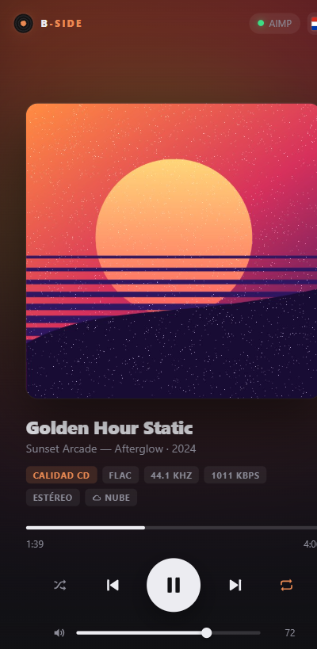
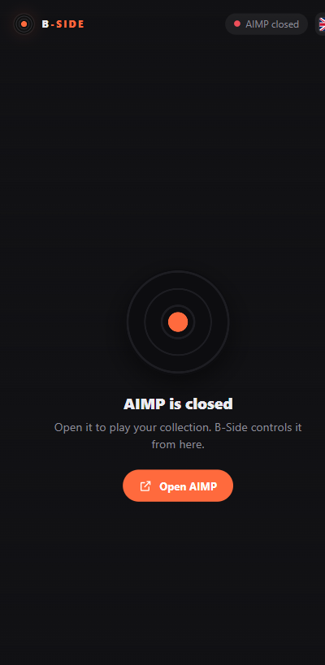

<p align="center">
  <a href="README.md"></a>&nbsp;<a href="README.md">English</a> &nbsp;·&nbsp;
  <a href="README.es.md"></a>&nbsp;<a href="README.es.md"><b>Español</b></a> &nbsp;·&nbsp;
  <a href="README.de.md"></a>&nbsp;<a href="README.de.md">Deutsch</a> &nbsp;·&nbsp;
  <a href="README.ja.md"></a>&nbsp;<a href="README.ja.md">日本語</a> &nbsp;·&nbsp;
  <a href="README.zh.md"></a>&nbsp;<a href="README.zh.md">中文</a> &nbsp;·&nbsp;
  <a href="README.ru.md"></a>&nbsp;<a href="README.ru.md">Русский</a>
</p>

<p align="center">
  
</p>

<p align="center">
  
  
  
  
  
</p>

# B-Side

Controla AIMP desde Orca: tu colección lossless mientras trabajas. [AIMP](https://www.aimp.ru)
transmite tu música desde la nube (OneDrive, Google Drive, Dropbox y más, con su **My Clouds**
integrado) y la reproduce; B-Side pone el reproductor en la barra lateral de Orca, para que no
tengas que salir del editor para cambiar de tema.

## Qué obtienes

<table>
  <tr>
    <td align="center"></td>
    <td align="center"></td>
    <td align="center"></td>
    <td align="center"></td>
  </tr>
  <tr>
    <td align="center"><sub>Reproduciendo</sub></td>
    <td align="center"><sub>En espera</sub></td>
    <td align="center"><sub>AIMP cerrado</sub></td>
    <td align="center"><sub>Sin conexión</sub></td>
  </tr>
</table>

- **Lo que suena**: portada (el panel toma de ella su color de acento), título, artista, álbum y año.
- **Formato real**: códec, frecuencia de muestreo, bitrate y canales tal como los informa AIMP, y una insignia de *calidad CD* para lossless a 44,1 kHz estéreo.
- **Controles**: reproducir/pausar, anterior, siguiente, avanzar en el tema (arrastra la barra o usa ←/→), volumen, aleatorio y repetir. `Espacio` pausa o reanuda.
- **Estados claros**: AIMP cerrado (con un botón *Abrir AIMP*), nada sonando, AIMP sin responder, sin conexión.
- **Tu idioma**: English, Español, Deutsch, 日本語, 中文 o Русский, desde la bandera de la esquina. Empieza en el idioma de Orca y recuerda tu elección; los temas claro y oscuro siguen a Orca.

*Las capturas usan un tema y una portada de demostración sintéticos.*

## Requisitos

- Windows 10 u 11
- [Git](https://git-scm.com/download/win)
- [Orca](https://github.com/stablyai/orca) 1.4.248 o posterior
- AIMP de Microsoft Store (el instalador lo consigue por ti, por usuario y sin administrador)

## Instalación rápida

Ejecuta esto en una terminal dentro de Orca (ahí está el comando `orca`). `-ExecutionPolicy Bypass` solo vale para esta ejecución, porque Windows bloquea los scripts por defecto.

```powershell
git clone https://github.com/icaceresc/b-side.git
cd b-side
powershell -ExecutionPolicy Bypass -File .\install.ps1
```

`install.ps1` instala AIMP si falta, corrige un error de configuración de la edición de la Store,
activa el streaming en My Clouds y carga el panel en Orca. La primera vez, Orca te pide aprobar
el plugin: ejecuta el comando `orca plugin dev load … --approve …` que muestra el script. Luego
abre **B-Side** en la barra lateral derecha de Orca. Puedes volver a ejecutar el script sin riesgo.

## Conecta tu nube (una sola vez)

1. En el panel de B-Side, pulsa **Abrir AIMP**.
2. En AIMP, abre la pestaña **My Clouds**, haz clic derecho en **All** en la columna izquierda y
   elige **Agregar almacenamiento…**.
3. Servicio: **OneDrive** (u otro) › **Obtener clave** › inicia sesión › permite el acceso › **Aceptar**.
4. Elige un álbum y dale a reproducir. Desde ahora, contrólalo desde Orca.


El acceso por streaming está activado, así que los temas no se descargan completos: AIMP solo
guarda en búfer lo que reproduce y vacía su caché al cerrarse.

## Calidad de sonido

B-Side nunca toca el audio: AIMP lo decodifica y lo reproduce. El instalador apaga los efectos
de AIMP (fundidos, normalizador, anti-clipping y tramado); el realce lo guarda AIMP por su cuenta, así
que revísalo en su ventana de efectos de sonido. Para que los archivos en
calidad CD lleguen a tus auriculares sin remuestreo, pon el formato de Windows del dispositivo a
la misma frecuencia: **Configuración › Sistema › Sonido › tu dispositivo › Configuración de
salida › Formato: 16 bits, 44100 Hz**. Los demás sonidos siguen escuchándose junto a la música.

¿Quieres el dispositivo solo para AIMP? En AIMP, **Preferencias › Reproducción › Dispositivo**:
elige la entrada *WASAPI Exclusive*. Las notificaciones y llamadas en ese dispositivo quedan en
silencio mientras suena AIMP.

## Cómo funciona

```text
Panel de Orca  ──plugin.request──▶  worker de B-Side (Node)  ──stdin/stdout──▶  helper (PowerShell + C#)  ──API remota de AIMP──▶  AIMP
```

- El helper habla con AIMP solo a través de su API remota oficial: mensajes de ventana y la
  memoria compartida `AIMP2_RemoteInfo`. Cada comando está en una lista permitida.
- El plugin solo pide a Orca su propio almacenamiento, para recordar tu idioma: ni red, ni
  terminal, ni espacios de trabajo, ni secretos.

## Privacidad

- Solo lee lo que muestra AIMP: título, artista, álbum, año, formato y portada del tema actual.
  Solo guarda tu idioma elegido, en el almacenamiento propio del plugin en Orca; no envía nada.
- Nunca toca tus archivos de música, tu cuenta en la nube ni su inicio de sesión. My Clouds
  inicia sesión dentro de AIMP.
- No escucha en ningún puerto de red. Con el panel visible, comprueba la conexión cada 30 s
  abriendo (y cerrando) una conexión TCP a `graph.microsoft.com:443`, sin enviar nada.
- Windows PowerShell compila la pequeña parte en C# del helper en `%TEMP%` cada vez que arranca.

## Limitaciones

- La API remota de AIMP no expone la lista de reproducción ni la profundidad de bits, así que
  B-Side no las muestra.
- Hecho y probado para AIMP 4.60 de Microsoft Store. AIMP 5 se instala para todo el equipo
  (requiere administrador).
- Solo el host local de Orca.
- En una PC unida a una cuenta de trabajo o estudio, Windows puede iniciar sesión en My Clouds con esa cuenta automáticamente. Usa una PC personal o una cuenta de Microsoft que Windows no administre.

## Recuperar y desinstalar

- **AIMP olvida su configuración al cerrarse**: ejecuta `powershell -ExecutionPolicy Bypass -File .\install.ps1 -SkipSettings`.
- **El panel dice que AIMP está cerrado y está abierto**: reinicia AIMP; el panel se reconecta solo.
- **Deshacer los cambios del instalador en AIMP**: la configuración original de AIMP queda a su
  lado como `AIMP.ini.b-side.bak`.
- **Desinstalar**: `orca plugin dev unload <ruta>\b-side\plugin`; después, si ya no quieres AIMP,
  desinstálalo desde Configuración de Windows › Aplicaciones, y borra el clon.

## Desarrollo

```powershell
orca plugin test plugin        # pruebas unitarias (node:test)
orca plugin validate plugin
orca plugin dev watch plugin --check --shot plugin\.orca\shots
```

`plugin/native/aimp-helper.ps1` es el único código que toca AIMP; el worker lo inicia con
`powershell.exe -EncodedCommand` y habla con él por stdin/stdout.

## Créditos y licencia

- B-Side: [Licencia MIT](LICENSE).
- [AIMP](https://www.aimp.ru), de Artem Izmaylov, y My Clouds son productos aparte y no se
  incluyen. Este es un proyecto independiente, no oficial de AIMP ni de Orca.
- Iconos de banderas: [lipis/flag-icons](https://github.com/lipis/flag-icons), [Licencia MIT](docs/flags/LICENSE).
