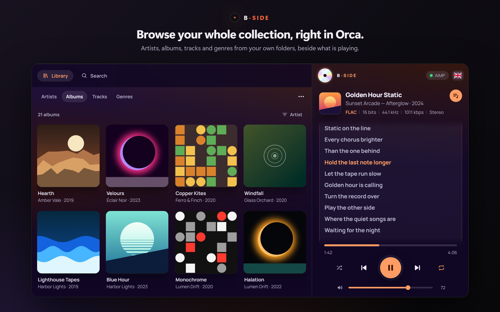
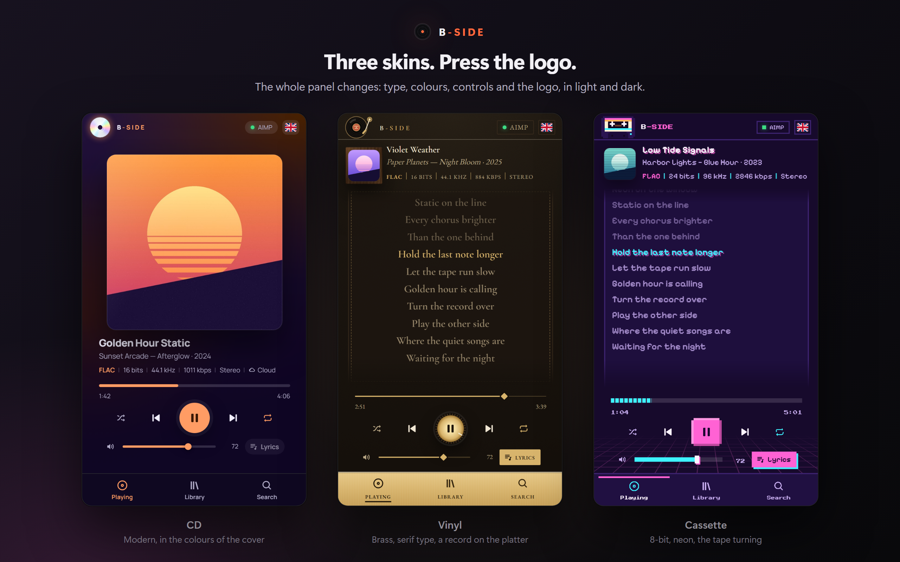

<p align="center">
  <a href="README.md">English</a> &nbsp;·&nbsp; <a href="README.es.md">Español</a> &nbsp;·&nbsp; <a href="README.de.md">Deutsch</a> &nbsp;·&nbsp; <b>日本語</b> &nbsp;·&nbsp; <a href="README.zh.md">中文</a> &nbsp;·&nbsp; <a href="README.ru.md">Русский</a>
</p>

<h1 align="center"><br>B-Side</h1>

<p align="center"><b>あなたの音楽ライブラリを、Orca のサイドバーに。</b><br>
PC にある音楽を見て、探して、再生。同期歌詞と 3 つのスキン付き。再生は AIMP が担当します。</p>

<p align="center">
  
</p>

<p align="center">
  <a href="https://github.com/icaceresc/b-side/actions/workflows/ci.yml"></a>
  
  <a href="LICENSE"></a>
</p>

### コレクション全体を、すぐそばに

自分のフォルダーにあるアーティスト、アルバム、曲、ジャンルを、ジャケットと各ファイルの実際の
フォーマット（FLAC · 24 ビット · 96 kHz）とともに表示。入力しながら検索でき、`rio` で *Río* が見つかります。

<p align="center"></p>

### 曲に合わせて進む歌詞

同期歌詞が 1 行ずつ光り、読みやすい大きさに変えられます。歌詞はファイルのタグか、曲の横に置いた
`.lrc` から読み込みます。

<p align="center"></p>

### 3 つのスキンと、一緒に演奏するロゴ

CD はジャケットごとの色をまとい、Vinyl は革と古い金、Cassette は 80 年代のテープデッキをピクセルで。
ロゴを押して切り替えます。ロゴは音楽が鳴っている間は回り、一時停止すると止まります。

<p align="center"></p>

### 軽く、ローカルで、プライベート

0.5 MB のネイティブヘルパーが、約 9 MB のメモリで AIMP とやり取りします。B-Side はフォルダーを
読むだけで、ファイルには触れず、あなたについての情報を送らず、トラッキングもしません。
[何を読み、書き、ダウンロードするか](docs/guide.ja.md#privacy)。

## インストール

Orca の中のターミナルで：

```powershell
orca plugin install icaceresc/b-side
```

Orca が B-Side に許可される内容を表示し、`--approve <コード>` を付けた同じコマンドを出力するので、それを
実行します。あとは右のサイドバーで **B-Side** を開き、音楽フォルダーを選ぶだけです。

**必要なもの：** Windows 10 または 11、[Orca](https://github.com/stablyai/orca) 1.4.248 以降、Microsoft Store の
[AIMP](https://www.aimp.ru)（無料）。AIMP がまだなら `install.ps1` が準備します：
[インストールの詳細](docs/guide.ja.md#install)。

## もっと知る

[フォルダーを選ぶ](docs/guide.ja.md#library-folders) · [できることすべて](docs/guide.ja.md#features) ·
[アップデート](docs/guide.ja.md#update) · [クラウドからのストリーミング（ベータ）](docs/guide.ja.md#two-ways-to-use-it) ·
[しくみ](docs/guide.ja.md#how-it-works) · [プライバシー](docs/guide.ja.md#privacy) ·
[トラブルシューティング](docs/guide.ja.md#troubleshooting) · [ヘルパーを確認する](docs/guide.ja.md#verify-helper) ·
[開発](docs/guide.ja.md#develop)

---

<sub>[MIT](LICENSE)。AIMP や Orca とは関係のない、独立したプロジェクトです。画像とデモ音楽は B-Side のために
作ったもので、架空のアーティスト、オリジナルの合成音楽、生成したジャケットを使っています。
[クレジット](docs/guide.ja.md#credits)。</sub>
