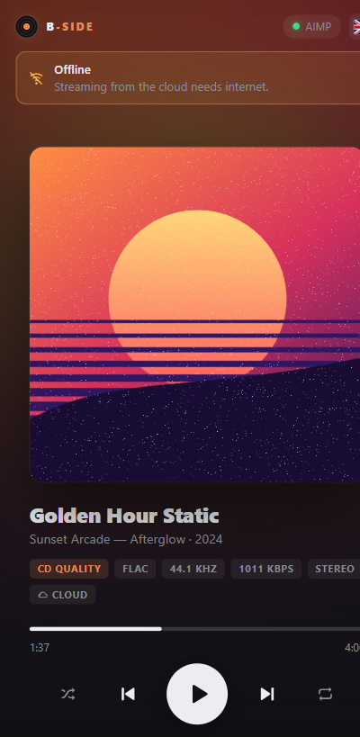

<p align="center">
  <a href="README.md"></a>&nbsp;<a href="README.md">English</a> &nbsp;·&nbsp;
  <a href="README.es.md"></a>&nbsp;<a href="README.es.md">Español</a> &nbsp;·&nbsp;
  <a href="README.de.md"></a>&nbsp;<a href="README.de.md">Deutsch</a> &nbsp;·&nbsp;
  <a href="README.ja.md"></a>&nbsp;<a href="README.ja.md"><b>日本語</b></a> &nbsp;·&nbsp;
  <a href="README.zh.md"></a>&nbsp;<a href="README.zh.md">中文</a> &nbsp;·&nbsp;
  <a href="README.ru.md"></a>&nbsp;<a href="README.ru.md">Русский</a>
</p>

<p align="center">
  
</p>

<p align="center">
  
  
  
  
  
</p>

# B-Side

Orca から AIMP を操作して、作業しながらロスレスのコレクションを。[AIMP](https://www.aimp.ru)
が内蔵の **My Clouds** でクラウド（OneDrive、Google Drive、Dropbox など）から音楽をストリーミング再生し、
B-Side がそのプレーヤーを Orca のサイドバーに置きます。曲を飛ばすためにエディターを離れる必要はありません。

## できること

<table>
  <tr>
    <td align="center"></td>
    <td align="center"></td>
    <td align="center"></td>
    <td align="center"></td>
  </tr>
  <tr>
    <td align="center"><sub>再生中</sub></td>
    <td align="center"><sub>待機中</sub></td>
    <td align="center"><sub>AIMP 停止</sub></td>
    <td align="center"><sub>オフライン</sub></td>
  </tr>
</table>

- **再生中の曲**：ジャケット（パネルのアクセントカラーはここから取ります）、曲名、アーティスト、アルバム、年。
- **実際のフォーマット**：AIMP が報告するコーデック、サンプルレート、ビットレート、チャンネル。ロスレスの 44.1 kHz ステレオには *CD 品質* バッジ。
- **操作**：再生/一時停止、前へ、次へ、シーク（バーをドラッグ、または ←/→）、音量、シャッフル、リピート。`Space` で再生と一時停止を切り替え。
- **わかりやすい状態表示**：AIMP 停止中（*Open AIMP* ボタン付き）、再生なし、AIMP が応答しない、オフライン。
- **好きな言語で**：English、Español、Deutsch、日本語、中文、Русский を右上の国旗から選べます。最初は Orca の言語で表示され、選んだ言語を覚えます。ライト/ダークテーマは Orca に合わせます。

*スクリーンショットは合成したデモ曲とジャケットを使っています。*

## 必要なもの

- Windows 10 または 11
- [Orca](https://github.com/stablyai/orca) 1.4.248 以降
- Microsoft Store 版 AIMP（インストーラーがユーザー単位で、管理者権限なしで入れます）

## クイックインストール

```powershell
git clone https://github.com/icaceresc/b-side.git
cd b-side
.\install.ps1
```

`install.ps1` は AIMP がなければインストールし、Store 版の設定保存の不具合を直し、My Clouds の
ストリーミングを有効にして、パネルを Orca に読み込みます。初回は Orca がプラグインの承認を求めるので、
スクリプトが表示する `orca plugin dev load … --approve …` を実行してください。あとは Orca の右サイドバーから
**B-Side** を開くだけです。スクリプトは何度実行しても安全です。

## クラウドをつなぐ（最初の一度だけ）

1. B-Side パネルで **Open AIMP** を押します。
2. AIMP の **My Clouds** タブを開き、左の列の **All** を右クリックして **ストレージに追加...** を選びます。
3. サービス：**OneDrive**（ほかのサービスも可）› **トークンを取得** › サインイン › アクセスを許可 › **OK**。
4. アルバムを選んで再生。ここから先は Orca で操作できます。

> **会社の PC で仕事用アカウントで自動サインインされる場合：** *（実験的：まだ確認されていません）* Windows が仕事用アカウントを AIMP に
> 自動で渡すことがあります。個人の Microsoft アカウントを使うには、**トークンを取得** を開いてから、
> 次のリンクをドラッグして AIMP の *Authorization Master* ウィンドウの中にドロップしてください（アドレスバーは
> 編集できません）：**[個人の Microsoft アカウントでサインイン](https://login.microsoftonline.com/consumers/oauth2/v2.0/authorize?client_id=a527d046-6111-4b9a-9855-f6a26b81b245&response_type=code&redirect_uri=http%3A%2F%2Flocalhost%2F&scope=Files.Read%20offline_access&prompt=select_account)**。
> このリンクは個人アカウントだけを受け付けます。

ストリーミングアクセスが有効なので、曲を丸ごとダウンロードすることはありません。AIMP は再生中の部分だけを
バッファーし、終了時にキャッシュを消去します。

## 音質

B-Side は音声に一切手を加えません。デコードと再生は AIMP が行います。インストーラーは AIMP のエフェクト
（エンハンサー、フェード、ノーマライザー、アンチクリッピング、ディザー）をオフにします。CD 品質のファイルを
リサンプリングなしでヘッドホンに届けるには、デバイスの Windows 側フォーマットを同じレートにします：
**設定 › システム › サウンド › 使用するデバイス › 出力設定 › 形式：16 ビット、44100 Hz**。
ほかのアプリの音も音楽と一緒に聞こえます。

デバイスを AIMP だけで使いたい場合は、AIMP の **設定 › 再生 › デバイス** で *WASAPI Exclusive* を選びます。
AIMP の再生中、そのデバイスの通知音や通話は聞こえなくなります。

## しくみ

```text
Orca パネル  ──plugin.request──▶  B-Side ワーカー (Node)  ──stdin/stdout──▶  ヘルパー (PowerShell + C#)  ──AIMP Remote API──▶  AIMP
```

- ヘルパーは AIMP 公式の Remote API（ウィンドウメッセージと共有メモリ `AIMP2_RemoteInfo`）だけを使って
  AIMP とやり取りします。コマンドはすべて許可リストで制限しています。
- プラグインが Orca に求めるのは、言語の設定を覚えるための専用ストレージだけです。ネットワーク、ターミナル、ワークスペース、シークレットは使いません。

## プライバシー

- 読み取るのは AIMP が表示している情報だけです：現在の曲の曲名、アーティスト、アルバム、年、フォーマット、
  ジャケット。保存するのは選んだ言語だけ（プラグイン専用の Orca ストレージ）で、何も送信しません。
- 音楽ファイル、クラウドのアカウント、そのサインインには一切触れません。My Clouds のサインインは AIMP の中で行われます。
- ネットワークポートで待ち受けることはありません。パネル表示中は 30 秒ごとに `graph.microsoft.com:443` への
  TCP 接続を開いて閉じ、接続状態だけを確認します（何も送信しません）。
- Windows PowerShell は、ヘルパーを起動するたびにその小さな C# 部分を `%TEMP%` でコンパイルします。

## 制限事項

- AIMP の Remote API はプレイリストもビット深度も公開していないため、B-Side はどちらも表示しません。
- Microsoft Store 版 AIMP 4.60 向けに作成・テストしています。AIMP 5 はマシン全体へのインストール（管理者権限）が必要です。
- ローカルの Orca ホストのみ対応。

## 復旧とアンインストール

- **AIMP が終了後に設定を忘れる**：`.\install.ps1 -SkipSettings` を実行します。
- **AIMP が開いているのにパネルが「閉じている」と表示する**：AIMP を再起動すれば、パネルは自動で再接続します。
- **インストーラーによる AIMP の変更を戻す**：元の設定は `AIMP.ini.b-side.bak` として同じ場所に保存されています。
- **アンインストール**：`orca plugin dev unload <パス>\b-side\plugin` を実行し、不要なら Windows の設定 › アプリで
  AIMP をアンインストールして、クローンを削除します。

## 開発

```powershell
orca plugin test plugin        # ユニットテスト (node:test)
orca plugin validate plugin
orca plugin dev watch plugin --check --shot plugin\.orca\shots
```

AIMP に触れるのは `plugin/native/aimp-helper.ps1` だけです。ワーカーは `powershell.exe -EncodedCommand`
でこれを起動し、stdin/stdout でやり取りします。

## クレジットとライセンス

- B-Side：[MIT ライセンス](LICENSE)。
- [AIMP](https://www.aimp.ru)（Artem Izmaylov 作）と My Clouds は別の製品で、本リポジトリには含まれません。
  これは独立したプロジェクトで、AIMP や Orca の公式プロジェクトではありません。
- 国旗アイコン：[lipis/flag-icons](https://github.com/lipis/flag-icons)、[MIT ライセンス](docs/flags/LICENSE)。
