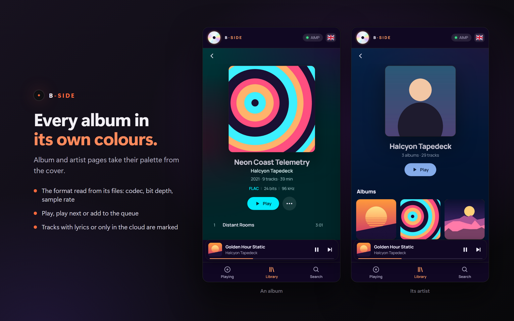
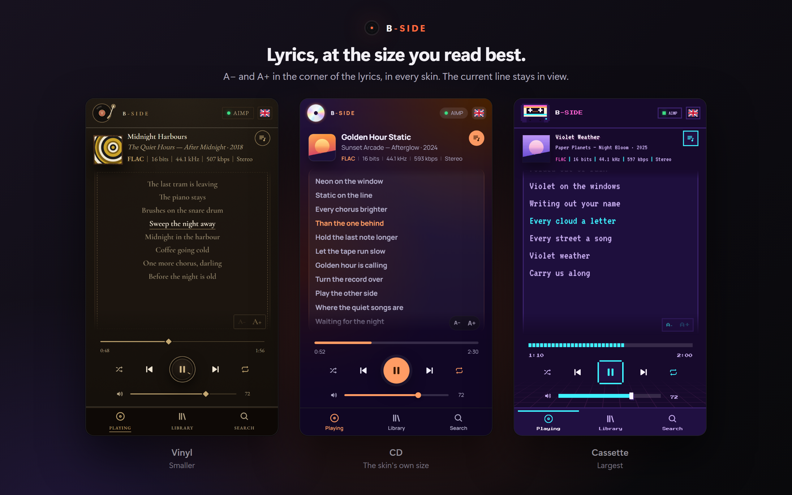
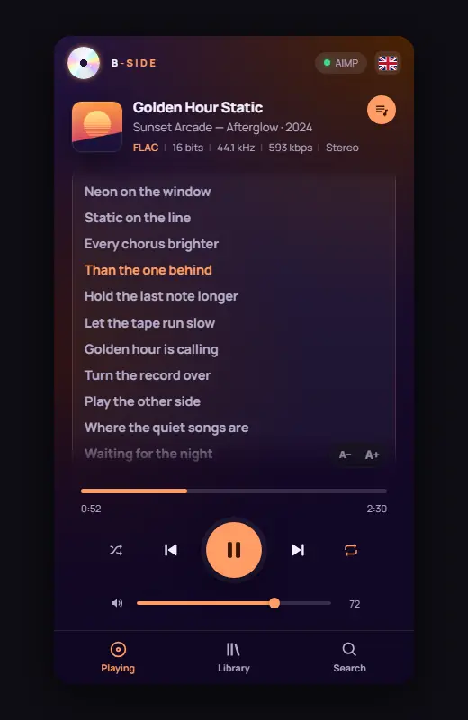
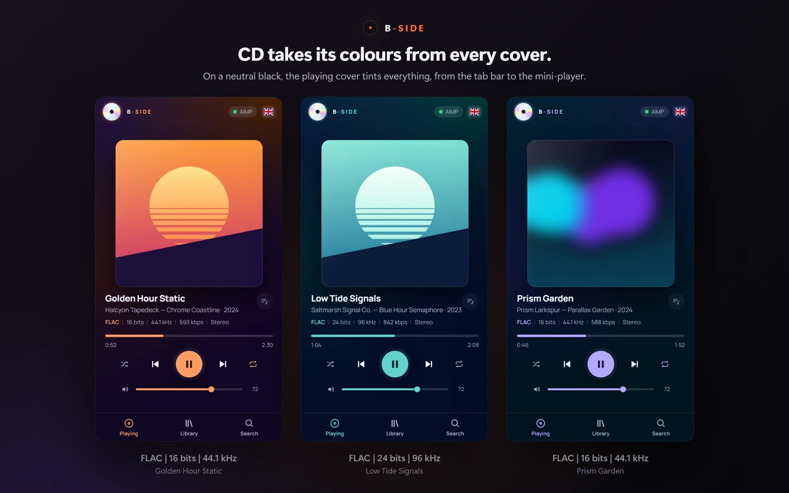
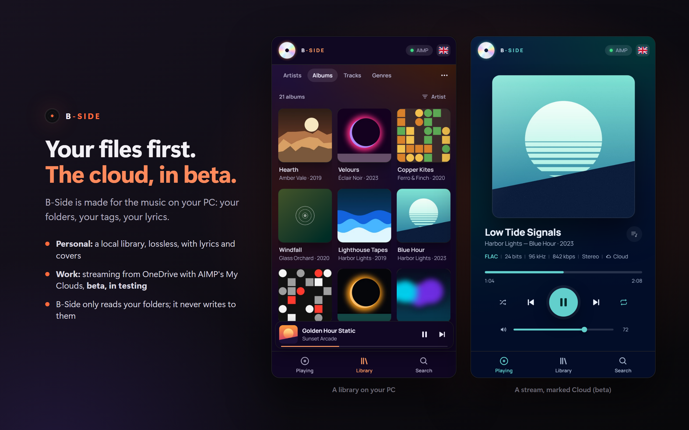
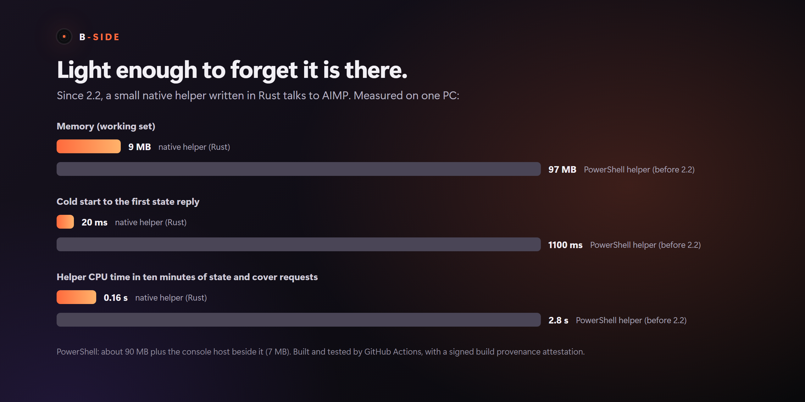
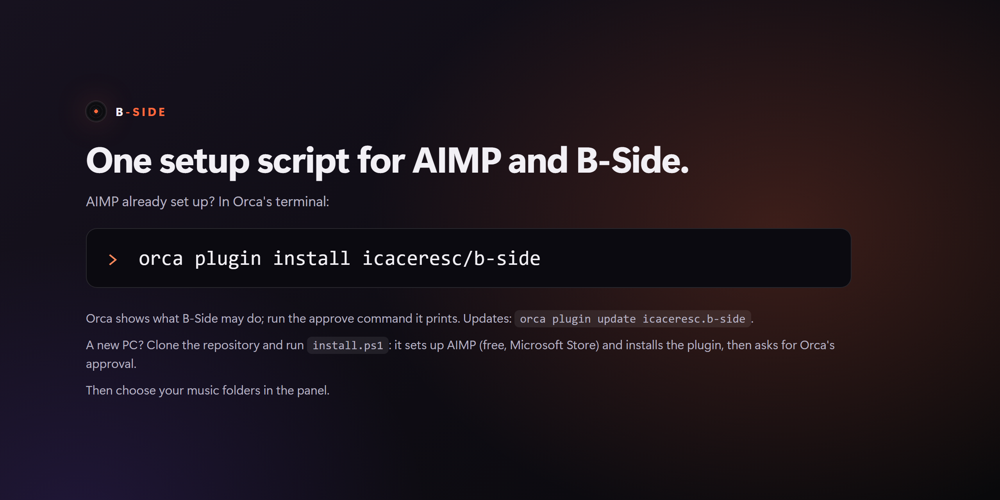

<p align="center">
  <a href="README.md"></a>&nbsp;<a href="README.md">English</a> &nbsp;·&nbsp;
  <a href="README.es.md"></a>&nbsp;<a href="README.es.md">Español</a> &nbsp;·&nbsp;
  <a href="README.de.md"></a>&nbsp;<a href="README.de.md">Deutsch</a> &nbsp;·&nbsp;
  <a href="README.ja.md"></a>&nbsp;<a href="README.ja.md"><b>日本語</b></a> &nbsp;·&nbsp;
  <a href="README.zh.md"></a>&nbsp;<a href="README.zh.md">中文</a> &nbsp;·&nbsp;
  <a href="README.ru.md"></a>&nbsp;<a href="README.ru.md">Русский</a>
</p>

<p align="center">
  
</p>

<p align="center">
  <a href="https://github.com/icaceresc/b-side/actions/workflows/ci.yml"></a>
  
  
  
  
  
</p>

# B-Side

自分のコレクションのための音楽アプリを、Orca のサイドバーに。B-Side は選んだ音楽フォルダーを
インデックスし、アーティスト、アルバム、曲、ジャンルで見て回れるようにし、入力するそばから探し出して、
[AIMP](https://www.aimp.ru) で再生します。AIMP はエンジンとしてバックグラウンドに控えます。
ロスレスのファイルも、そのジャケットも歌詞も、エディターを離れずに。まずは PC 上の音楽のために作られています。クラウドからのストリーミングはベータ版です。

## ツアー

### ライブラリ

自分のフォルダーのアーティスト、アルバム、曲、ジャンル。ジャケットと、各アルバムのファイルから読んだフォーマット付き。

<p align="center"></p>

### 検索

アーティスト、アルバム、曲をすぐに検索。アクセントや大文字小文字は区別しません。

<p align="center"></p>

### アルバムページ

各アルバムをジャケットの色で。フォーマットは 1 行で：FLAC | 24 ビット | 96 kHz。

<p align="center"></p>

### 再生中と歌詞

同期歌詞は曲に合わせて進み、現在の行をハイライトします。歌詞の右下の A− と A+ で 4 つのサイズから選べ、B-Side はどのスキンでも覚えています。

<p align="center"></p>

### 3 つのスキン

左上のロゴを押して CD、レコード、カセットを選びます。パネル全体が変わり、音楽はそのまま流れます。

<p align="center"></p>

### ジャケットごとの色

CD スキンでは、再生中のジャケットがニュートラルな黒の上でパネル全体を染め、文字は読みやすいままです。

<p align="center"></p>

### まずは手元のファイル、クラウドはベータ

B-Side は PC 上の音楽のために作られています。AIMP の My Clouds による OneDrive からのストリーミングはベータ版で、まだテスト中です。

<p align="center"></p>

### PC に軽い

2.2 から、Rust で書かれた小さなネイティブヘルパーが AIMP と通信します。ある Windows PC では、メモリは 97 MB に対し約 9 MB、最初の応答は 1.1 秒に対し 20 ms、10 分間の使用での CPU 時間は 2.8 秒に対し 0.16 秒でした（`scripts/measure-helper.mjs`）。

<p align="center"></p>

## できること

- **ライブラリ**：ファイルのタグから作るアーティスト、アルバム、曲、ジャンル。タグがないときはフォルダー名と
  ファイル名で補います（`Artist\Album\01 Title.flac`）。アルバムはアーティスト、タイトル、年で並べ替えられ、
  曲の一覧は 1 万曲でもなめらかにスクロールします。
- **アーティストとアルバムのページ**：アルバムのジャケットやアーティスト画像の色に染まります。アルバムページには
  ファイルから読んだフォーマット（コーデック、サンプルレート、ビット深度）、
  ディスクと長さが表示され、歌詞のある曲やクラウドにしかない曲に印が付きます。
- **再生**：アルバムはそのページから、アーティストのアルバムはアーティストページから再生できます。曲を押すと、
  その曲からアルバムの最後まで再生します。曲やアルバムのメニュー（**⋯**）には **次に再生**、
  **キューに追加**、**アルバムへ移動**、**アーティストへ移動** があります。AIMP が閉じていれば、
  再生すると起動します。
- **検索**：アーティスト、アルバム、曲をすぐに検索。大文字小文字やアクセントは区別せず（`rios` で
  *Ríos de Ámbar y Sal* が見つかります）、日本語や中国語の名前の中の語も見つけます。パネルのどこからでも `/` または
  `Ctrl+K` で検索に移れます。
- **再生中**：ジャケット、曲名、アーティスト、アルバム（それぞれライブラリのページを開きます）、1 行の
  フォーマット（`FLAC | 16 ビット | 44.1 kHz | 738 kbps | ステレオ`）、そしてすべての操作：再生/一時停止、
  前へ、次へ、シーク（バーをドラッグするか ←/→）、音量、ミュート、シャッフル、リピート。`Space` で再生と
  一時停止を切り替えます。
- **歌詞**：ファイルのタグ（FLAC `LYRICS`/`UNSYNCEDLYRICS`、MP3 `USLT`/`SYLT`）または曲の隣の `.lrc` から。
  歌詞のある曲では再生中の画面に表示されます。同期歌詞は現在の行をハイライトしながら曲に合わせて進み、行を押すと
  その位置へ移動します。曲名の横の丸い **歌詞** ボタンで、どのスキンでも表示と非表示を切り替えられます。歌詞が
  ない曲では、その理由を伝えます。
- **サイドバーのために**：幅が狭いときはスマートフォンのアプリのように、再生中、ライブラリ、検索のタブと
  ミニプレーヤーで動きます。サイドバーを広げると、ライブラリや検索が左に、再生中が右に並びます。
- **ジャケットの色**（CD スキン）：ニュートラルな黒をベースに、再生中のジャケットのパレットがタブバーから
  ミニプレーヤーまですべての面を染め、ライトでもダークでも文字は読みやすいまま（WCAG AA）。アルバムページは
  そのアルバム自身のジャケットの色になります。
- **わかりやすい状態表示**：フォルダーの選択、スキャン中、AIMP が閉じている（*AIMP を開く* ボタン付き）、
  AIMP が応答しない、オフライン。
- **あなたの言語で**：隅の国旗から English、Español、Deutsch、日本語、中文、Русский を選べます。最初は Orca の
  言語で始まり、選んだ言語を覚えます。ライト／ダークのテーマは Orca に合わせます。

<a id="skins"></a>

### スキン

<p align="center"></p>

左上のロゴを押してスキンを選びます。B-Side は選択を覚えます。どのスキンもパネル全体（再生中、ライブラリ、検索、歌詞、ミニプレーヤー、フォーマット行）を Orca のライト／ダークテーマで作り変え、文字は WCAG AA のコントラストを保ちます。

- **CD**（デフォルト）：いまの B-Side をさらに洗練。ニュートラルな黒に Manrope。再生中のジャケットの色がすべての面を染め、ほぼモノクロのジャケットはほぼ黒のまま控えめなアクセントになります。
- **レコード**：真空管アンプのような、レザーとウォルナットと古金のリスニングルーム。Cormorant と EB Garamond、スモールキャップ、選択中のタブを細い金で示す暗いタブバー、シャンパンゴールドのリングが付いた暗いノブ。
- **カセット**：ピクセルで描いた 80 年代のカセットデッキ。VT323 と Press Start 2P、ウォークマンのキーのようなシアンの縁取りを付けた濃い紫、小さなアクセントとしてのフューシャ、LED の進行メーター。

<p align="center"></p>

ロゴは AIMP と一緒に動きます。CD は固定の光沢の下で虹色に回り、レコードは 33⅓ で回ってトーンアームが下り、一時停止で上がります。カセットのリールが回ります。アニメーションは音楽が鳴っていてパネルが見えているときだけ動き、Windows の「アニメーション効果」がオフなら止まります（その場合もロゴは光、ランプ、レコード上のトーンアームで再生中を示します）。

<p align="center"></p>
<p align="center"></p>

*スクリーンショットとアニメーションは B-Side のデモライブラリを使っています：架空のアーティスト、オリジナルの合成音楽、生成したジャケット（`docs/demo/make-demo.py`）。*

## 必要なもの

- Windows 10 または 11
- [Git](https://git-scm.com/download/win)
- [Orca](https://github.com/stablyai/orca) 1.4.248 以降
- Microsoft Store 版 AIMP（インストーラーがユーザー単位で、管理者権限なしで入れます）

## インストール

<p align="center"></p>

手順は 2 つです。どちらも Orca 内のターミナルで実行します（`orca` コマンドが使えます）。

**1. プラグインをインストールする**

```powershell
orca plugin install icaceresc/b-side
```

B-Side はあなたの PC でコードを実行します。ライブラリを読み、AIMP とやり取りするために Orca が起動する
小さなワーカー（*trusted worker*）です。そのため初回は Orca がいったん止まり、プラグインに与えられるもの
（専用のストレージと専用の設定だけ）を示して、末尾に `--approve <コード>` を付けた同じコマンドを表示します。
そのコマンドを実行すると、承認してインストールします。

**2. AIMP を準備する**

```powershell
git clone https://github.com/icaceresc/b-side.git
cd b-side
powershell -ExecutionPolicy Bypass -File .\install.ps1
```

Windows は既定でスクリプトをブロックするため、`-ExecutionPolicy Bypass` はこの 1 回の実行にだけ
適用されます。`install.ps1` は AIMP がなければインストールし、Store 版の設定保存の不具合を直し、
My Clouds のストリーミングを有効にします。手順 1 も代わりに行います。GitHub からプラグインを
インストールまたは更新し、Orca が承認を求めたらその承認コマンドを表示するので、新しい PC ではこの
スクリプトだけで済みます。何度実行しても安全です。オプション：

- `-SkipSettings`: AIMP のインストールと設定保存の不具合の修正だけを行い、AIMP の設定には触れません。
- `-SkipPlugin`: AIMP の準備だけを行い、プラグインはインストールしません。

あとは Orca の右サイドバーから **B-Side** を開き、音楽フォルダーを選ぶだけです。

<a id="library-folders"></a>

## 音楽フォルダーを選ぶ

最初に、パネルが音楽の場所をたずねます。この PC で音楽が入ったフォルダーを提案します：Windows の
ミュージックフォルダーと、各 OneDrive の音楽フォルダー（*Music*、*Música*、*Musik*、*音楽*…）で、それぞれ
大きなサブフォルダーと曲数も示します。1 つ以上選ぶか、別のフォルダーのパスを貼り付けて、
**これらのフォルダーを使う** を押します。B-Side が読み込めるフォルダーは 16 個までです。

フォルダーはいつでも変えられます。パネル（ライブラリのオプションの **フォルダーを変更**）か、Orca の
**Settings › Plugins › B-Side › Library folders** で 1 行に 1 つずつ指定します。この設定が空なら、B-Side は
Windows のミュージックフォルダーを使います。

インデックス作成はバックグラウンドで行われ、その間も見て回れます。428 個の FLAC ファイルのコレクションでは
最初のスキャンが約 2 秒でした。以後、パネルは保存したインデックスですぐに開き、次のスキャンでは変更された
ファイルだけを読み直します。

## アップデート

```powershell
orca plugin update icaceresc.b-side
```

新しいバージョンがより多くのアクセスを求める場合にだけ、Orca は再び承認を求めます。**B-Side 2.0 は
1.2.x からの更新時に一度だけ求めます**：音楽フォルダーのための専用の設定（`settings:own`）が加わるためです。
Orca はその変更を示し、`--approve <コード>` を付けた同じコマンドを表示するので、それを実行してください。
承認するまでは、今のバージョンがそのまま動きます。最新の `install.ps1` も使うには、クローンで `git pull` を
実行してください。スクリプトを再実行するとプラグインも更新されます。

<a id="aimp-setting"></a>

## B-Side が AIMP で再生するしくみ

AIMP の Remote API は再生を操作できますがファイルを読み込めないため、B-Side はエクスプローラーと同じ方法で
曲を AIMP に渡します。アルバムや曲を再生すると、B-Side は AIMP に最初の曲を開くよう頼みます。AIMP は
プレイリスト **Default** を空にしてその曲を追加し、再生します。続いて B-Side がアルバムの残りを追加します。
**キューに追加** は AIMP が再生中のプレイリストの最後に曲を追加し、**次に再生** は再生中の曲のすぐ後ろに
入れます（AIMP が自分のプレイリストを再生しているときは最後に）。何も再生していなければ、どちらも曲を
再生します。

これは AIMP の 1 つの設定に依存しており、B-Side がそれを変えることはありません：**環境設定 › プレイリスト ›
ファイルの追加 › 外部アプリケーションからファイルを追加 › デフォルト動作** を AIMP の既定値
**空のプレイリストに追加** のままにしておいてください（英語では *Preferences › Playlist › File adding ›
Open files from external applications › Default action: Add to empty playlist "Default"*）。ほかの値でも AIMP は
曲を再生しますが、毎回新しいプレイリストのタブに入ったり（*新規プレイリストを作成*）、開いているプレイリストに
追加されたり（*現在のプレイリストに追加*）し、アルバムの残りはそのプレイリストの最後に入ります。

途中の曲から始めるとき、B-Side はアルバムやリスト全体を読み込み、AIMP をミュートしたまま（その間だけ
シャッフルもオフにして）「次へ」で選んだ曲まで進めます。そのため「前へ」で前の曲にも戻れます。約 2 秒
かかり、その後ミュートとシャッフルは元の状態に戻ります。

<a id="two-ways-to-use-it"></a>

## 2 つの使い方

> **ベータ版。** B-Side は PC 上のコレクションですぐに使えます。クラウドからのストリーミング（仕事用の構成と My Clouds）はベータ版でまだテスト中です。設定ガイドはそのまま残しています。

**個人の PC：すべてローカル。** 音楽をこの PC のフォルダー（または *このデバイス上で常に保持する* にした
OneDrive）に置きます。ディスク上のファイルではすべてが使えます：タグ、ジャケット、歌詞、アーティスト画像。
B-Side が探すものは次の構成でそろいます：

```text
Music\
  Artist\
    artist.jpg            アーティスト画像
    Album\
      cover.jpg           アルバムのジャケット（ファイルのタグにない場合）
      01 Title.flac
      01 Title.lrc        歌詞（ファイルのタグにない場合のみ）
```

**職場の PC：ストリーミングのみ。** OneDrive の *ファイル オンデマンド* を使った OneDrive の音楽フォルダーを
B-Side に指定すれば、コレクションはクラウドに置いたままです。クラウドにしかないファイルはフォルダー名と
ファイル名から一覧にし、B-Side が開いたり読んだりすることはありません（読むとダウンロードされるためです）。
それらのジャケットや歌詞は、そのファイル（`cover.jpg` や `.lrc`）がすでに PC にある場合にだけ表示されます。
曲を再生すると AIMP がそれを開き、OneDrive がダウンロードします。その後 OneDrive は、開いたほかのファイルと
同じように、エクスプローラーでそのファイルに **空き領域を増やす** を選ぶまで PC に保持します。パネルは
OneDrive にしかない曲やアルバムに印を付けます。

<a id="my-clouds"></a>

## My Clouds からストリーミングする（任意、ベータ）

AIMP は内蔵の **My Clouds** で、OneDrive、Google Drive、Dropbox などから、この PC にファイルをコピーせずに
ストリーミングすることもできます。それらの曲は B-Side のライブラリには入りません。AIMP で選ぶと、B-Side の
再生中タブが表示と操作を行います（ジャケット、曲の情報、ジャケットの色。歌詞とアーティスト画像には PC 上の
ファイルが必要です）。

1. B-Side パネルで **AIMP を開く** を押します。
2. AIMP の **My Clouds** タブを開き、左の列の **All** を右クリックして **ストレージに追加...** を選びます。
3. サービス：**OneDrive**（ほかのサービスも可）› **トークンを取得** › サインイン › アクセスを許可 › **OK**。
   職場や学校のアカウントがある PC では、先に[職場・学校の PC](#work-account)を読んでください。
4. アルバムを選んで再生します。

インストーラーがストリーミングアクセスを有効にするので、曲を丸ごとダウンロードすることはありません。AIMP は
再生中の部分だけをバッファーし、終了時にキャッシュを消去します。

<a id="work-account"></a>

> **⚠ 職場・学校の PC：My Clouds には個人のアカウントでサインインしてください。**
>
> Windows に職場や学校のアカウントでサインインしていると、**トークンを取得** が開く Microsoft の
> サインインページがそのアカウントを自動で選ぶことがあり、その場合 My Clouds は職場の OneDrive から
> ストリーミングします。AIMP › **My Clouds** › **ストレージに追加...** › **OneDrive** › **トークンを取得**
> で **別のアカウントを使用する** を選び、個人の Microsoft アカウントでサインインしてください。
> アカウントの種類を聞かれたら **個人用アカウント** を選びます。Windows に職場や学校のアカウントがあると、
> インストーラーが警告します。
>
> - **確認**：My Clouds でそのストレージを開きます。個人の OneDrive のフォルダー（あなたの音楽）が
>   見えれば正しいアカウントです。仕事のファイルや、見覚えのない空の OneDrive が見えたら職場の
>   アカウントです。
> - **修正**：ストレージを右クリック › **ストレージを編集...** › **トークンを取得** で、個人のアカウントで
>   サインインし直します。または右クリック › **ストレージを除去...**（キャッシュも消すには
>   **ローカル キャッシュを削除** にチェック）してから追加し直します。

## 音質

B-Side は音声に一切手を加えません。デコードと再生は AIMP が行います。インストーラーは AIMP のエフェクト
（フェード、ノーマライザー、アンチクリッピング、ディザー）をオフにします。エンハンサーは AIMP 自身が
保持するため、サウンドエフェクトの画面で確認してください。CD 品質のファイルを
リサンプリングなしでヘッドホンに届けるには、デバイスの Windows 側フォーマットを同じレートにします：
**設定 › システム › サウンド › 使用するデバイス › 出力設定 › 形式：16 ビット、44100 Hz**。
ほかのアプリの音も音楽と一緒に聞こえます。

デバイスを AIMP だけで使いたい場合は、AIMP の **設定 › 再生 › デバイス** で *WASAPI Exclusive* を選びます。
AIMP の再生中、そのデバイスの通知音や通話は聞こえなくなります。

## しくみ

```text
Orca パネル ──plugin.request──▶ B-Side ワーカー (Node) ──stdin/stdout──▶ ヘルパー (ネイティブ、Rust) ──▶ AIMP
再生中 · ライブラリ · 検索      インデックス、タグ、                   Remote API：状態、操作、ジャケット
                                検索、キュー                           シェル動詞：開く、プレイリストに追加
                                      │                                フォルダーの一覧、サムネイル
                                      ▼
                         %LOCALAPPDATA%\B-Side\cache
                         library.json · サムネイル · キュー
```

- **ライブラリ**：ヘルパーはディレクトリの情報（名前、サイズ、日時、Windows の属性）だけでフォルダーを
  一覧にするので、一覧を作るときにファイルは 1 つも開きません。ワーカーはローカルファイルのタグを読み取り専用で
  読み、アーティスト、アルバム、曲、ジャンルを組み立てて、インデックスを
  `%LOCALAPPDATA%\B-Side\cache\library.json` に保存します。ジャケットとアーティスト画像は、その隣で小さな
  サムネイルになります。Orca を再起動すると、保存したインデックスですぐに応答し、バックグラウンドで更新します。
  パネルが受け取るのは名前と不透明な ID だけで、ファイルのパスは渡りません。
- **再生**：ヘルパーは AIMP 自身のファイルの関連付けで、エクスプローラーと同じように曲を開きます（*開く*、
  アルバムの残りには AIMP の *プレイリストに追加*。`%LOCALAPPDATA%\B-Side\queue` に置く短い `.m3u8` リストを
  使い、B-Side が 10 分後に削除します）。それ以外（状態、再生/一時停止、シーク、音量、ジャケット）は AIMP 公式の
  Remote API（ウィンドウメッセージと共有メモリ `AIMP2_RemoteInfo`）を通ります。コマンドはすべて許可リストで
  制限しています。
- **ヘルパー** は小さなネイティブプログラム（`bside-helper-x64.exe`、または `-arm64.exe`、約 0.5 MB）で、
  `native/helper` の Rust コードからビルドしています。何もインストールしなくても動き、使うメモリは数 MB、
  応答は 1 秒に満たない速さです。リポジトリにはプログラムを含めていません。初めて使うとき、B-Side は
  自分と同じバージョンの GitHub リリースからこの PC 用のものをダウンロードし、その SHA-256 がそのバージョンの
  コードに固定された値と一致するときだけ実行します（[ヘルパーを確認する](#verify-helper)）。それまでのあいだ
  （ダウンロード中、オフライン、ダウンロードや確認の失敗）や、起動できない場合（たとえばウイルス対策ソフトや
  職場の PC のポリシーにブロックされたときなど）は、B-Side が代わりに PowerShell で書かれた同じヘルパー
  （`native/aimp-helper.ps1`）を使い、そのことをログ（`orca plugin logs icaceresc.b-side`）に記録します。
  こちらは C# 部分を一度だけキャッシュフォルダーにコンパイルします。
- Orca はワーカーを *trusted worker* として実行します。この PC 上であなたのユーザーアカウントと同じ
  権限を持つ Node プロセスなので、Orca は承認を求めます。Orca 自体の権限として求めるのは、専用のストレージ
  （言語と、パネルを最後に見ていた場所）と専用の設定（音楽フォルダー）だけです。ターミナル、ワークスペース、
  シークレットは使いません。

## プライバシー

- 選んだフォルダーを読み取り専用で読みます：その一覧と、PC 上にあるファイルのタグ、埋め込みジャケット、歌詞、
  画像です。クラウドにしかないファイルは開きません。再生中の曲について AIMP が報告する情報（曲名、
  アーティスト、アルバム、年、フォーマット、ジャケット）も読みます。
- 音楽ファイルを書き換えたり、移動・削除したりすることはありません。書き込むのは `%LOCALAPPDATA%\B-Side`
  （インデックス、サムネイル、キュー、`helper\<バージョン>` にダウンロードしたネイティブヘルパー。PowerShell 版
  ヘルパーが動いた場合はそのビルドも）と、Orca の専用ストレージと設定だけです。
  フォルダーのパスはこの PC から出ず、何も送信しません。
- クラウドのアカウントとそのサインインには一切触れません。OneDrive と My Clouds は自分でサインインします。
- ネットワークを使うのは次の 2 つだけです。バージョンごとに一度、ネイティブヘルパー（約 0.5 MB）を HTTPS で
  `https://github.com/icaceresc/b-side/releases/download/v<version>/bside-helper-<x64|arm64>.exe`
  からダウンロードします（GitHub は自社のダウンロード用サーバーから配信します）。送るのはそのリクエストだけです。
  ダウンロードに失敗したら、後の起動時に、10 分、1 時間、6 時間、1 日と間隔をあけて再試行します。止めるには
  **設定 › Plugins › B-Side › Native helper** をオフにします。B-Side は常に PowerShell 版ヘルパーを使い、
  ダウンロードしなくなります。また、クラウドからストリーミングした曲の再生中、30 秒ごと（確認に失敗した
  あとは 5 秒ごと）に `graph.microsoft.com:443` への TCP 接続を開いて閉じ、何も送らずに接続を確認します。
  PC 上のファイルにはそれ以外何も要りません。どのポートでも待ち受けません。

## 制限事項

- Microsoft Store 版 AIMP 4.60 向けに作成・テストしています。AIMP 5 はマシン全体へのインストール（管理者権限）が必要です。
- 再生には、ほかのアプリから開いたファイルに対する AIMP の **デフォルト動作** が既定値のままであることが
  必要です（[B-Side が AIMP で再生するしくみ](#aimp-setting)）。
- **次に再生** は、AIMP が曲を最後にしか追加できない
  ため、再生中の曲を同じ位置から再開し、短い途切れが入ります。
- B-Side は AIMP のプレイリストを表示しません。再生中のフォーマットは AIMP が報告するもので、ファイルが
  ライブラリにあればビット深度も加わります。アルバムページはファイルから読んだフォーマットを表示します。
- My Clouds からストリーミングした曲はライブラリに入らず、歌詞もアーティスト画像も表示されません。
- 音楽フォルダーは 16 個まで。ローカルの Orca ホストのみ対応。
- 職場や学校のアカウントがある PC では、My Clouds がそのアカウントでサインインすることがあります。[職場・学校の PC](#work-account) を参照してください。

## 復旧とアンインストール

- **ライブラリが空、または古い**：フォルダーを確認し（**フォルダーを変更**、または Orca の
  **Settings › Plugins › B-Side › Library folders**）、**再スキャン** を押します。
- **曲を再生するたびに AIMP に新しいプレイリストのタブができる**：AIMP の **デフォルト動作** を
  **空のプレイリストに追加** に戻します（[B-Side が AIMP で再生するしくみ](#aimp-setting)）。
- **AIMP が終了後に設定を忘れる**：クローンで `powershell -ExecutionPolicy Bypass -File .\install.ps1 -SkipSettings -SkipPlugin` を実行します。
- **AIMP が開いているのにパネルが「閉じている」と表示する**：AIMP を再起動すれば、パネルは自動で再接続します。
- **ウイルス対策ソフトが `bside-helper-x64.exe` をブロックする**：B-Side は PowerShell 版ヘルパーで動き続けます
  （ログに `using the powershell helper` と出ます）。[そのファイルが B-Side のものか確認](#verify-helper)して
  ウイルス対策ソフトで許可すれば、次に Orca を起動したときに B-Side がそれを使います（ウイルス対策ソフトが
  削除していれば、もう一度ダウンロードします）。ダウンロードしたプログラムを使いたくない PC では、Orca の
  **設定 › Plugins › B-Side** で **Native helper** をオフにしてください。
- **インストーラーによる AIMP の変更を戻す**：元の設定は `AIMP.ini.b-side.bak` として同じ場所に保存されています。
- **アンインストール**：`orca plugin uninstall icaceresc.b-side` を実行します（`-Dev` で読み込んだ場合は
  `orca plugin dev unload <パス>\b-side`）。不要なら Windows の設定 › アプリで AIMP をアンインストールして、
  クローンを削除します。インデックスも消すには `%LOCALAPPDATA%\B-Side` を削除します。

<a id="verify-helper"></a>

## ヘルパーを確認する

ネイティブヘルパーはあなたの PC ではビルドされず、リポジトリにも含まれていません。GitHub Actions がこの
リポジトリのコード（`native/helper`、`native/build.mjs` 使用）からビルドし、すべてのテストをそれに対して実行して、
[ビルドの来歴証明](https://docs.github.com/actions/security-for-github-actions/using-artifact-attestations)に署名します。
各リリースにはそのビルド `bside-helper-x64.exe` と `bside-helper-arm64.exe` を、SHA-256 を記した `SHA256SUMS` と
ともに添付しており、同じ SHA-256 がそのバージョンのコード（`src/native-helper.mjs`）に固定されています。初めて
使うとき、B-Side は自分と同じバージョンのリリースからこの PC 用のビルドだけをダウンロードして
`%LOCALAPPDATA%\B-Side\helper\<バージョン>` に保存し、SHA-256 が固定値と一致するときだけ実行します。一致しない
ファイルは実行せずに削除し、理由をログに残します。B-Side の新しいバージョンは自分のビルドをダウンロードし、
古いものを削除します。コード署名証明書では署名していないため、Windows には発行元が表示されません。

- **チェックサムを比べる**：リリースの `SHA256SUMS` と照らします：

  ```powershell
  Get-ChildItem "$env:LOCALAPPDATA\B-Side\helper" -Recurse -Filter bside-helper-*.exe | Get-FileHash
  ```

- **どこでビルドされたか確認する**：[GitHub CLI](https://cli.github.com) で、そのファイル、またはリリースの
  ファイルに対して実行します：

  ```powershell
  gh attestation verify "$env:LOCALAPPDATA\B-Side\helper\<バージョン>\bside-helper-x64.exe" --repo icaceresc/b-side
  ```

  ファイルをビルドしたワークフローとコミットが表示されます。クローンでは、`node native/verify.mjs` が
  ダウンロードしたヘルパー（または `--dir <フォルダー>` でリリースのファイル）に同じ確認をし、固定された SHA-256 と、
  そのコミットのヘルパーコードがお手元のコピーと同じかどうかも確かめます。
- **自分でビルドする**：[Rust](https://rustup.rs) と Visual Studio の C++ ビルドツール（arm64 は ARM64 ツール
  も）をインストールし、`node native/build.mjs x64` を実行します。rustup がリリースで使っている Rust の
  バージョン（`native/helper/rust-toolchain.toml`）を取得します。ビルドは決定的です：GitHub のランナーと同じ
  バージョンのコンパイラーとリンカーなら同じバイト列に、違うバージョンなら同じプログラムになります。
  `native/bin`（Git の管理外）にビルドがあるクローンはそれを使い、何もダウンロードしません。
- **ダウンロードしない**：**設定 › Plugins › B-Side** で **Native helper** をオフにします。B-Side は
  PowerShell 版ヘルパーを使います。こちらは `native/aimp-helper.ps1` にあるプレーンテキストです。

## 開発

すべてリポジトリのルートから実行します：

```powershell
orca plugin test .        # ユニットテスト (node:test)
orca plugin validate .
orca plugin dev watch . --check --shot .orca/shots
powershell -ExecutionPolicy Bypass -File .\install.ps1 -Dev    # GitHub 版の代わりにこのフォルダーを読み込む
```

AIMP に触れるのはヘルパーだけです。`native/helper`（Rust）を `node native/build.mjs` で `native/bin` に
ビルドしたもの（Git の管理外。そこにビルドがあればダウンロードの代わりに使います）と、その PowerShell 版 `native/aimp-helper.ps1` です。後者は、ネイティブ版が起動できない
ときに、ワーカーが `powershell.exe -EncodedCommand` に渡す小さなローダーで起動します。どちらも
stdin/stdout で同じ JSON 行をやり取りし、`test/helper-parity.test.mjs` が同じ応答になることを確認します。
`native/helper` で `cargo test` を実行すると Rust のテストが走り、
`node scripts/measure-helper.mjs --helper native` はメモリ、起動時間、CPU を測ります。
ライブラリは `src/library/`、再生は `src/playback.mjs`、パネルは `panel/` にあります。GitHub Actions が
CI ワークフロー（上のバッジ）を Windows で実行します。

Orca のプラグインページ用のアイコン、カバー、スクリーンショットは `python docs/make-assets.py`
（Pillow と Chrome または Edge）で作ります。合成したデモ用ライブラリで実際のパネルを描画するので、パネルを
変えたら再実行してください。

## クレジットとライセンス

- B-Side：[MIT ライセンス](LICENSE)。
- [AIMP](https://www.aimp.ru)（Artem Izmaylov 作）と My Clouds は別の製品で、本リポジトリには含まれません。
  これは独立したプロジェクトで、AIMP や Orca の公式プロジェクトではありません。
- 国旗アイコン：[lipis/flag-icons](https://github.com/lipis/flag-icons)、[MIT ライセンス](panel/flags/LICENSE)。
- スキンのフォント：[Manrope](https://github.com/sharanda/manrope), [EB Garamond](https://github.com/octaviopardo/EBGaramond12), [Cormorant Garamond](https://github.com/CatharsisFonts/Cormorant), [Pixelify Sans](https://github.com/eifetx/Pixelify-Sans)、[Press Start 2P](https://github.com/codeman38/PressStart2P)、[VT323](https://github.com/phoikoi/VT323)、[SIL Open Font License 1.1](panel/fonts/)、プラグインに同梱。
