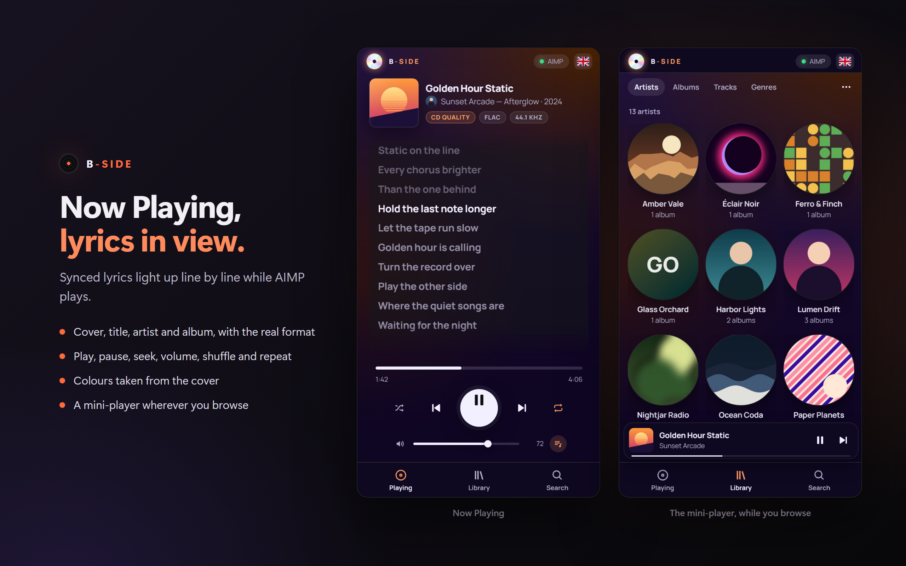
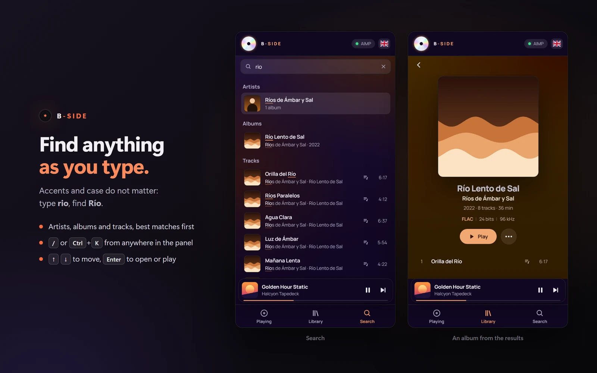
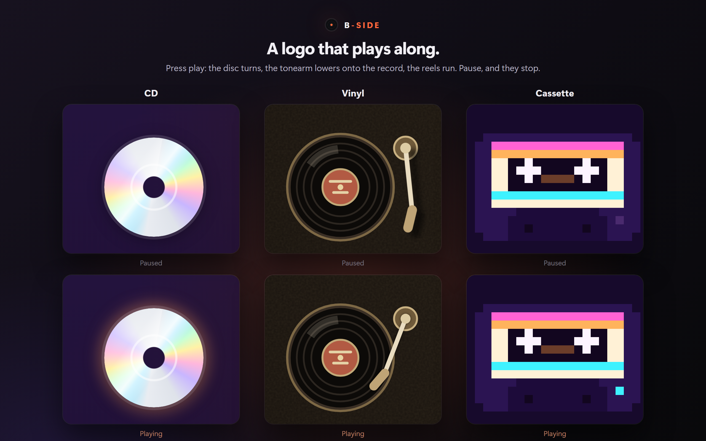

<p align="center">
  <a href="README.md"></a>&nbsp;<a href="README.md"><b>English</b></a> &nbsp;·&nbsp;
  <a href="README.es.md"></a>&nbsp;<a href="README.es.md">Español</a> &nbsp;·&nbsp;
  <a href="README.de.md"></a>&nbsp;<a href="README.de.md">Deutsch</a> &nbsp;·&nbsp;
  <a href="README.ja.md"></a>&nbsp;<a href="README.ja.md">日本語</a> &nbsp;·&nbsp;
  <a href="README.zh.md"></a>&nbsp;<a href="README.zh.md">中文</a> &nbsp;·&nbsp;
  <a href="README.ru.md"></a>&nbsp;<a href="README.ru.md">Русский</a>
</p>

<p align="center">
  
</p>

<p align="center">
  <a href="https://github.com/icaceresc/b-side/actions/workflows/ci.yml"></a>
  
  
  
  
  
</p>

# B-Side

A music app for your own collection, in Orca's sidebar. B-Side indexes the music folders you
choose, lets you browse them by artist, album, track and genre, finds anything as you type and
plays it through [AIMP](https://www.aimp.ru), which stays in the background as the engine. Your
lossless files, their covers and their lyrics, without leaving your editor.

## What you get

<table>
  <tr>
    <td align="center" width="50%"></td>
    <td align="center" width="50%"></td>
  </tr>
  <tr>
    <td align="center"><sub>Library</sub></td>
    <td align="center"><sub>Album</sub></td>
  </tr>
  <tr>
    <td align="center"></td>
    <td align="center"></td>
  </tr>
  <tr>
    <td align="center"><sub>Playing</sub></td>
    <td align="center"><sub>Search</sub></td>
  </tr>
</table>

- **Library**: Artists, Albums, Tracks and Genres, from your files' tags, with folder and file
  names standing in when a tag is missing (`Artist\Album\01 Title.flac`). Albums sort by artist,
  title or year; the Tracks list scrolls smoothly through ten thousand tracks.
- **Artist and album pages**: tinted from the album cover or the artist's picture. An album page
  shows the format read from its files (codec, sample rate, bit depth, *Lossless*, *Hi-Res*), its
  discs and durations, and marks the tracks that have lyrics or are only in the cloud.
- **Play**: play an album from its page, an artist's albums from the artist page, or press a track
  to play from it to the end of its album. The menu of a track or an album (**⋯**) has
  **Play next**, **Add to queue**, **Go to album** and **Go to artist**. If AIMP is closed,
  playing starts it.
- **Search**: instant, across artists, albums and tracks. It ignores case and accents (`rosalia`
  finds *Rosalía*) and finds words inside Japanese or Chinese names. `/` or `Ctrl+K` brings you
  there from anywhere in the panel.
- **Playing**: cover, title, artist and album (each opens its library page), the real format AIMP
  reports with a *CD quality* badge for lossless 44.1 kHz stereo, and every control: play/pause,
  previous, next, seek (drag the bar or use ←/→), volume, mute, shuffle and repeat. `Space`
  toggles playback.
- **Lyrics**: from the file's tags (FLAC `LYRICS`/`UNSYNCEDLYRICS`, MP3 `USLT`/`SYLT`) or a `.lrc`
  beside the track, shown on Playing whenever the track has them. Synced lyrics follow the song;
  press a line to jump there. When a track has none, the **Lyrics** button says why.
- **Made for the sidebar**: narrow, it works like a phone app, with Playing, Library and Search tabs
  and a mini-player; drag the sidebar wider and the library or search sits on the left with
  Playing on the right.
- **Cover colors**: the background and accent come from the cover's palette, with the text kept
  readable in light and dark.
- **Clear states**: choosing your folders, scanning, AIMP closed (with an *Open AIMP* button), AIMP
  not responding, offline.
- **Your language**: English, Español, Deutsch, 日本語, 中文 or Русский, from the flag in the corner.
  It starts in Orca's language and remembers your pick; light and dark themes follow Orca.

<a id="skins"></a>

### Skins

<p align="center"></p>

Press the logo in the top-left corner and pick a skin; B-Side remembers it. Each one restyles the whole panel (Playing, Library, Search, lyrics, the mini-player and the quality badges) in Orca's light and dark themes, with text that keeps WCAG AA contrast.

- **CD** (the default): today's B-Side, refined. Manrope type, glass bars and the colours of the playing cover.
- **Vinyl**: a listening room in brass, walnut and ivory. Cormorant and EB Garamond, small capitals, gold hairlines and the cover framed like a print.
- **Cassette**: 8-bit vaporwave. Pixel type (Pixelify Sans and Press Start 2P), neon on violet, hard pixel shadows and an LED progress meter.

<p align="center"></p>

The logo plays along with AIMP: the CD turns, iridescent, under a fixed glint; the record turns at 33⅓ and the tonearm lowers onto it, then lifts off when you pause; the cassette's reels run. Animations run only while music plays and the panel is visible, and stop when Windows' *Animation effects* are off (the logo still shows playing with a glow, a light or the tonearm on the record).

<p align="center"></p>
<p align="center"></p>

*Screenshots use a synthetic demo library and covers.*

## Requirements

- Windows 10 or 11
- [Git](https://git-scm.com/download/win)
- [Orca](https://github.com/stablyai/orca) 1.4.248 or later
- AIMP from the Microsoft Store (the installer gets it for you, per user, no admin)

## Install

Two steps, both in a terminal inside Orca (it provides the `orca` command).

**1. Install the plugin.**

```powershell
orca plugin install icaceresc/b-side
```

B-Side runs code on your PC: a small worker that Orca starts to read your library and talk to AIMP
(a *trusted worker*). So the first time, Orca stops and shows what the plugin would get (its own
storage and its own settings, nothing else) and prints the same command with `--approve <code>` at
the end. Run that command to approve and install it.

**2. Prepare AIMP.**

```powershell
git clone https://github.com/icaceresc/b-side.git
cd b-side
powershell -ExecutionPolicy Bypass -File .\install.ps1
```

`-ExecutionPolicy Bypass` only applies to this one run, since Windows blocks scripts by default.
`install.ps1` installs AIMP if it is missing, fixes a settings bug of AIMP's Store edition and
turns on streaming in My Clouds. It also does step 1 for you: it installs or updates the plugin
from GitHub and prints the approve command when Orca asks for it, so on a new PC this one script
is enough. Running it again is safe. Options:

- `-SkipSettings`: install AIMP and fix the settings bug, but leave AIMP's settings untouched.
- `-SkipPlugin`: only prepare AIMP; do not install the plugin.

Then open **B-Side** from Orca's right sidebar and choose your music folders.

<a id="library-folders"></a>

## Choose your music folders

The first time, the panel asks where your music is. It suggests the folders that hold music on
this PC: the Windows Music folder and the music folder of each OneDrive (*Music*, *Música*,
*Musik*, *音楽*…), each with its big subfolders and how many tracks they hold. Pick one or more, or
paste the path of another folder, and press **Use these folders**. B-Side reads up to 16 folders.

You can change them at any time, from the panel (**Change folders** in the library's options), or
in Orca's **Settings › Plugins › B-Side › Library folders**, one folder per line. With the setting
left empty, B-Side uses the Windows Music folder.

Indexing happens in the background and you can browse while it runs. On a collection of 428 FLAC
files the first scan took about 2 seconds; after that the panel opens with the saved index at once,
and later scans read again only the files that changed.

## Update

```powershell
orca plugin update icaceresc.b-side
```

Orca asks for approval again only when a new version asks for more access. **B-Side 2.0 does, once,
when you update from 1.2.x**: it adds its own settings (`settings:own`) for the library folders.
Orca then lists that change and prints the same command with `--approve <code>`; run it. Until
you approve, the version you have keeps working. For the newest `install.ps1` too, run `git pull`
in the clone; running the script again also updates the plugin.

<a id="aimp-setting"></a>

## How B-Side plays in AIMP

AIMP's Remote API can control playback but cannot load files, so B-Side hands tracks to AIMP the way
Explorer does. When you play an album or a track, B-Side asks AIMP to open the first track; AIMP
clears its playlist **Default**, adds the track and plays it. B-Side then adds the rest of the album
after it. **Add to queue** adds tracks at the end of the playlist AIMP is playing, and **Play next**
puts them right after the playing track (at the end, when AIMP plays a playlist of its own). With
nothing playing, both play the tracks.

This relies on one AIMP setting, which B-Side never changes: **Preferences › Playlist ›
File adding › Open files from external applications › Default action**, left at AIMP's default,
**Add to empty playlist "Default"**. With another choice, AIMP still plays the track, but in a new
playlist tab each time (*Create new playlist*) or added to the playlist already open (*Add to
current playlist*), and the rest of the album goes to the end of that playlist.

To start at a track, B-Side loads the whole album or list and moves AIMP to your track with Next
while AIMP is muted (with shuffle off for that moment), so Previous reaches the tracks before it.
It takes about two seconds; then mute and shuffle are as you had them.

<a id="two-ways-to-use-it"></a>

## Two ways to use it

**Personal PC: everything local.** Keep your music in folders on this PC (or in OneDrive, set to
*Always keep on this device*). Files on your disk get everything: tags, covers, lyrics and artist
pictures. This layout gives B-Side what it looks for:

```text
Music\
  Artist\
    artist.jpg            the artist's picture
    Album\
      cover.jpg           the album cover, if it is not in the files' tags
      01 Title.flac
      01 Title.lrc        lyrics, only if they are not in the file's tags
```

**Work PC: streaming only.** Point B-Side at your OneDrive music folder with OneDrive's
*Files On-Demand*, so the collection stays in the cloud. Files that are only in the cloud are listed
from their folder and file names; B-Side never opens or reads them, since that would download them.
Their covers and lyrics show only when those files (`cover.jpg`, a `.lrc`) are already on the PC.
When you play a track, AIMP opens it and OneDrive downloads it; OneDrive then keeps that file on the
PC, like any file you open, until you choose **Free up space** on it in Explorer. The panel marks
tracks and albums that are only in OneDrive.

<a id="my-clouds"></a>

## Stream from My Clouds (optional)

AIMP can also stream from OneDrive, Google Drive, Dropbox and more through its built-in
**My Clouds**, without copying files to this PC. Those tracks are not in B-Side's library: you pick
them in AIMP, and B-Side's Playing tab shows and controls them (cover, details and cover colors;
lyrics and the artist picture need files on the PC).

1. In the B-Side panel, press **Open AIMP**.
2. In AIMP, open the **My Clouds** tab, right-click **All** in the left column and choose
   **Add Storage...**.
3. Service: **OneDrive** (or another) › **Get Token** › sign in › allow access › **OK**.
   On a PC with a work or school account, read [Work or school PC](#work-account) first.
4. Pick an album and press play.

The installer turns on streaming access, so tracks are not downloaded whole: AIMP only buffers what
it plays and clears its cache when it closes.

<a id="work-account"></a>

> **⚠ Work or school PC: sign My Clouds in with your personal account.**
>
> When Windows is signed in to a work or school account, the Microsoft sign-in page that
> **Get Token** opens may pick that account by itself, and My Clouds would then stream from your
> work OneDrive. In AIMP › **My Clouds** › **Add Storage...** › **OneDrive** › **Get Token**,
> choose **Use another account** and sign in with your personal Microsoft account; if Microsoft
> asks which kind of account, pick **Personal account**. The installer warns you when Windows has
> a work or school account.
>
> - **Check**: open the storage in My Clouds. You should see your personal OneDrive's folders
>   (your music). Work files, or an empty OneDrive you do not recognize, mean the work account.
> - **Fix**: right-click the storage › **Edit Storage...** › **Get Token** and sign in again with
>   your personal account. Or right-click › **Remove Storage...** (tick **Delete local cache** to
>   drop its cached files too) and add it again.

## Sound quality

B-Side never touches the audio: AIMP decodes and plays it. The installer switches off AIMP's
effects (fades, normalizer, anti-clipping, dither); check AIMP's own sound effects window
for its enhancer, which AIMP keeps by itself. For CD-quality files to reach your
headphones without resampling, set the device's Windows format to the same rate:
**Settings › System › Sound › your device › Output settings › Format: 16 bit, 44100 Hz**. Other
sounds keep playing alongside the music.

Want the device all to yourself? In AIMP, **Preferences › Playback › Device**: pick the
*WASAPI Exclusive* entry. Notifications and calls on that device go silent while AIMP plays.

## How it works

```text
Orca sidebar panel ──plugin.request──▶ B-Side worker (Node) ──stdin/stdout──▶ helper (native, Rust) ──▶ AIMP
Playing · Library · Search             library index, tags,                   Remote API: state, controls, cover
                                       search, play queue                     shell verbs: open, add to playlist
                                             │                                folder listing, thumbnails
                                             ▼
                                %LOCALAPPDATA%\B-Side\cache
                                library.json · thumbnails · play queue
```

- **Library**: the helper lists your folders from the directory alone (names, sizes, dates and
  Windows attributes), so listing opens no file. The worker reads the tags of local files,
  read-only, builds artists, albums, tracks and genres, and saves the index in
  `%LOCALAPPDATA%\B-Side\cache\library.json`; covers and artist pictures become small thumbnails
  next to it. A restarted Orca answers from the saved index at once and refreshes it in the
  background. The panel gets names and opaque ids, never file paths.
- **Playback**: the helper opens a track with AIMP's own file associations, as Explorer does
  (*open*, and AIMP's *Add to playlist* for the rest of the album, from a short `.m3u8` list in
  `%LOCALAPPDATA%\B-Side\queue` that B-Side deletes after 10 minutes). Everything else (state,
  play/pause, seek, volume, the cover) goes through AIMP's official Remote API: window messages
  and the `AIMP2_RemoteInfo` shared memory. Every command is on an allow-list.
- **The helper** is a small native program (`native/bin/bside-helper-x64.exe`, or `-arm64.exe`,
  about 0.5 MB) built from the Rust code in `native/helper`: it needs nothing installed, uses a few
  MB of memory and answers in a fraction of a second. If it cannot start, for example because an
  antivirus or a work PC's policy blocks it, B-Side uses the same helper written in PowerShell
  (`native/aimp-helper.ps1`) instead and says so in its log (`orca plugin logs icaceresc.b-side`);
  that one compiles its C# part once into the cache folder.
- Orca runs the worker as a *trusted worker*: a Node process with your user account's access
  to this PC, which is why Orca asks you to approve it. Of Orca's own permissions it asks only
  for its own storage (your language and where you left the panel) and its own settings (the library
  folders): no terminal, workspace or secrets access.

## Privacy

- Reads, read-only, the folders you choose: their listing, and the tags, embedded covers, lyrics
  and images of the files that are on the PC. Files that are only in the cloud are never opened.
  It also reads what AIMP reports about the playing track: title, artist, album, year, format and
  cover.
- Never writes to, moves or deletes your music files. It writes only in `%LOCALAPPDATA%\B-Side`
  (the index, thumbnails and play queue, plus the PowerShell helper's build if it ever runs) and in
  its own Orca storage and settings.
  Folder paths stay on this PC; nothing is sent anywhere.
- Never touches your cloud account or its sign-in. OneDrive and My Clouds sign in on their own.
- Uses no network beyond this: while the panel is visible, it checks connectivity every 30 s by
  opening (and closing) a TCP connection to `graph.microsoft.com:443`, sending nothing. It listens
  on no port.

## Limitations

- Built and tested for AIMP 4.60 from the Microsoft Store. AIMP 5 installs machine-wide (admin).
- Playing relies on AIMP's **Default action** for files from other apps being left at its default
  ([How B-Side plays in AIMP](#aimp-setting)).
- **Play next** restarts the
  playing track at the same point, with a short gap, because AIMP can only add tracks at the end.
- B-Side does not show AIMP's playlist. On Playing, the format is what AIMP reports, which has no
  bit depth; album pages show the bit depth from the files' tags.
- Tracks streamed from My Clouds are not in the library, and show no lyrics or artist picture.
- Up to 16 library folders. Local Orca host only.
- On a PC with a work or school account, My Clouds may sign in with that account: see [Work or school PC](#work-account).

## Recover and uninstall

- **The library is empty or out of date**: check the folders (**Change folders**, or Orca's
  **Settings › Plugins › B-Side › Library folders**) and press **Scan again**.
- **Playing a track adds a new playlist tab in AIMP each time**: set AIMP's **Default action** back to
  **Add to empty playlist "Default"** ([How B-Side plays in AIMP](#aimp-setting)).
- **AIMP forgets its settings after closing**: in the clone, run `powershell -ExecutionPolicy Bypass -File .\install.ps1 -SkipSettings -SkipPlugin`.
- **Panel says AIMP is closed while it is open**: restart AIMP; the panel reconnects by itself.
- **An antivirus blocks `bside-helper-x64.exe`**: B-Side keeps working through the PowerShell
  helper (the log says `using the powershell helper`). You can [check that the file is
  B-Side's](#verify-helper) and allow it in the antivirus; B-Side picks it up the next time Orca
  starts.
- **Undo the installer's AIMP changes**: AIMP's original settings are saved next to them as
  `AIMP.ini.b-side.bak`.
- **Uninstall**: `orca plugin uninstall icaceresc.b-side` (or `orca plugin dev unload <path-to>\b-side`
  if you loaded it with `-Dev`), then uninstall AIMP from Windows Settings › Apps if you no
  longer want it, and delete the clone. To drop the index too, delete `%LOCALAPPDATA%\B-Side`.

<a id="verify-helper"></a>

## Check the helper

The native helper is not built on your PC: GitHub Actions builds it from the code in this
repository (`native/helper`, with `native/build.mjs`), runs every test against it, and signs a
[build provenance attestation](https://docs.github.com/actions/security-for-github-actions/using-artifact-attestations)
for it. The files in `native/bin` are those builds, and each release lists their SHA-256 in
`SHA256SUMS`. It is not signed with a code-signing certificate, so Windows shows no publisher for
it.

- **Compare the checksum** with the one in the release (and in `native/bin/SHA256SUMS`). Orca
  keeps installed plugins in `%APPDATA%\orca\plugins`:

  ```powershell
  Get-ChildItem "$env:APPDATA\orca\plugins\icaceresc.b-side" -Recurse -Filter bside-helper-*.exe | Get-FileHash
  ```

- **Check where it was built**, with the [GitHub CLI](https://cli.github.com), on that file or on
  the one from the release:

  ```powershell
  gh attestation verify bside-helper-x64.exe --repo icaceresc/b-side
  ```

  It names the workflow and the commit that built the file. `node native/verify.mjs` does the same
  for both binaries and checks that the commit has the same helper code as your copy.
- **Build it yourself**: install [Rust](https://rustup.rs) and the Visual Studio C++ build tools
  (with the ARM64 tools for arm64), then `node native/build.mjs x64`. rustup fetches the Rust
  version the releases use (`native/helper/rust-toolchain.toml`). The build is deterministic: with
  the same compiler and linker versions as GitHub's runner you get the same bytes; with others,
  the same program.

## Develop

Everything runs from the repository root:

```powershell
orca plugin test .        # unit tests (node:test)
orca plugin validate .
orca plugin dev watch . --check --shot .orca/shots
powershell -ExecutionPolicy Bypass -File .\install.ps1 -Dev    # load this folder instead of the GitHub version
```

The helper is the only code that touches AIMP: `native/helper` (Rust), built into `native/bin`
with `node native/build.mjs`, and its PowerShell twin `native/aimp-helper.ps1`, which the worker
starts with a small loader passed to `powershell.exe -EncodedCommand` when the native one cannot
start. Both speak the same JSON lines over stdin/stdout, and `test/helper-parity.test.mjs` checks
that they answer alike; `cargo test` in `native/helper` runs the Rust tests and
`node scripts/measure-helper.mjs --helper native` measures memory, start time and CPU. The
library lives in `src/library/`, playback in `src/playback.mjs` and the panel in
`panel/`. GitHub Actions runs the CI workflow (badge above) on Windows.

The icon, cover and screenshots for Orca's plugin page come from `python docs/make-assets.py`
(Pillow, plus Chrome or Edge): it renders the real panel with a synthetic demo library, so rerun
it when the panel changes.

## Credits and license

- B-Side: [MIT License](LICENSE).
- [AIMP](https://www.aimp.ru) by Artem Izmaylov and My Clouds are separate products, not
  included. This is an independent project, not an official AIMP or Orca project.
- Flag icons: [lipis/flag-icons](https://github.com/lipis/flag-icons), [MIT License](panel/flags/LICENSE).
- Fonts of the skins: [Manrope](https://github.com/sharanda/manrope), [EB Garamond](https://github.com/octaviopardo/EBGaramond12), [Cormorant Garamond](https://github.com/CatharsisFonts/Cormorant), [Pixelify Sans](https://github.com/eifetx/Pixelify-Sans) and [Press Start 2P](https://github.com/codeman38/PressStart2P), [SIL Open Font License 1.1](panel/fonts/), embedded in the plugin.
