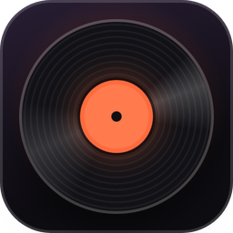

<p align="center">
  <a href="README.md">English</a> &nbsp;·&nbsp; <a href="README.es.md">Español</a> &nbsp;·&nbsp; <a href="README.de.md">Deutsch</a> &nbsp;·&nbsp; <a href="README.ja.md">日本語</a> &nbsp;·&nbsp; <a href="README.zh.md">中文</a> &nbsp;·&nbsp; <b>Русский</b>
</p>

<h1 align="center"><br>B-Side</h1>

<p align="center"><b>Ваша медиатека — в боковой панели Orca.</b><br>
Просматривайте, ищите и слушайте музыку со своего ПК с Windows, с синхронным текстом песен и тремя оформлениями. Играет через AIMP — бесплатный плеер.</p>

<p align="center">
  
</p>

<p align="center">
  <a href="https://github.com/icaceresc/b-side/actions/workflows/ci.yml"></a>
  
  <a href="LICENSE"></a>
</p>

### Вся коллекция — в одно нажатие

Исполнители, альбомы, треки и жанры из ваших папок, с обложками и форматом, прочитанным из каждого
файла (FLAC · 24 бита · 96 кГц). Нажмите `/` или `Ctrl+K` и печатайте: `rio` находит *Río*.

<p align="center"></p>

### Текст, который идёт вместе с песней

Синхронный текст подсвечивается строка за строкой; A− и A+ меняют его размер. Он берётся из тегов
файлов или из `.lrc` рядом с треком.

<p align="center"></p>

### Три оформления и логотип, который играет вместе с музыкой

CD принимает цвета каждой обложки, Винил — это кожа и старое золото, Кассета — кассетная дека 80-х в
пикселях. Нажмите на логотип, чтобы выбрать оформление; логотип вращается, пока играет музыка, и
замирает на паузе.

<p align="center"></p>

### Локально и приватно

B-Side только читает ваши папки с музыкой и никогда не меняет файлы. Без аккаунта и без слежки: когда
музыка на ПК, сеть нужна лишь для того, чтобы один раз скачать с GitHub собственного помощника
(0,5 МБ), проверенного по SHA-256, и это можно отключить.
[Что он читает, пишет и скачивает](docs/guide.ru.md#privacy).

## Установка

В терминале внутри Orca:

```powershell
orca plugin install icaceresc/b-side
```

Orca покажет, что будет разрешено B-Side, и выведет ту же команду с `--approve <код>`: выполните её.
Затем откройте **B-Side** в правой боковой панели и выберите папки с музыкой.

**Нужны** Windows 10 или 11, [Orca](https://github.com/stablyai/orca) 1.4.248 или новее и
[AIMP из Microsoft Store](https://apps.microsoft.com/detail/9PCLLLH15SMT) (бесплатно). Ещё нет AIMP? `install.ps1` всё подготовит:
[Подробно об установке](docs/guide.ru.md#install).

## Подробнее

[Выбор папок](docs/guide.ru.md#library-folders) ·
[Все возможности](docs/guide.ru.md#features) ·
[Решение проблем](docs/guide.ru.md#troubleshooting) ·
[Конфиденциальность](docs/guide.ru.md#privacy) ·
[Обновление](docs/guide.ru.md#update) ·
[Потоковое воспроизведение из облака (бета)](docs/guide.ru.md#two-ways-to-use-it) ·
[Как это работает](docs/guide.ru.md#how-it-works) ·
[Проверка помощника](docs/guide.ru.md#verify-helper) ·
[Разработка](docs/guide.ru.md#develop)

---

<sub>[MIT](LICENSE). Независимый проект, не связанный ни с AIMP, ни с Orca. Изображения и демо-музыка сделаны для
B-Side: вымышленные исполнители, оригинальная синтезированная музыка и сгенерированные обложки. [Благодарности](docs/guide.ru.md#credits).</sub>
