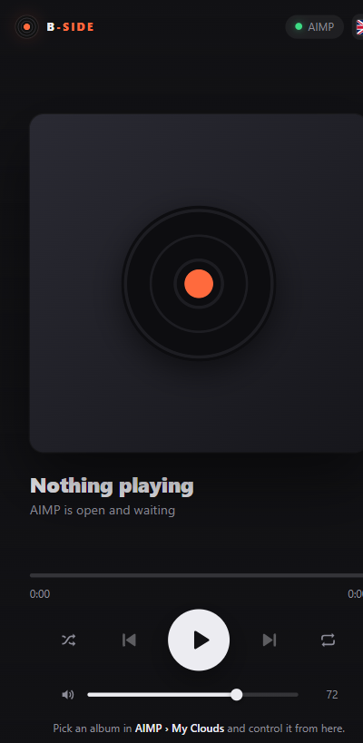

<p align="center">
  <a href="README.md"></a>&nbsp;<a href="README.md">English</a> &nbsp;·&nbsp;
  <a href="README.es.md"></a>&nbsp;<a href="README.es.md">Español</a> &nbsp;·&nbsp;
  <a href="README.de.md"></a>&nbsp;<a href="README.de.md">Deutsch</a> &nbsp;·&nbsp;
  <a href="README.ja.md"></a>&nbsp;<a href="README.ja.md">日本語</a> &nbsp;·&nbsp;
  <a href="README.zh.md"></a>&nbsp;<a href="README.zh.md"><b>中文</b></a> &nbsp;·&nbsp;
  <a href="README.ru.md"></a>&nbsp;<a href="README.ru.md">Русский</a>
</p>

<p align="center">
  
</p>

<p align="center">
  
  
  
  
  
</p>

# B-Side

在 Orca 里控制 AIMP：边工作边听你的无损收藏。[AIMP](https://www.aimp.ru) 通过内置的 **私有云**
（My Clouds）从云端（OneDrive、Google Drive、Dropbox 等）串流并播放音乐；B-Side 把播放器放进 Orca 的
侧边栏，切歌不必离开编辑器。

## 你能得到什么

<table>
  <tr>
    <td align="center"></td>
    <td align="center"></td>
    <td align="center"></td>
    <td align="center"></td>
  </tr>
  <tr>
    <td align="center"><sub>播放中</sub></td>
    <td align="center"><sub>等待中</sub></td>
    <td align="center"><sub>AIMP 已关闭</sub></td>
    <td align="center"><sub>离线</sub></td>
  </tr>
</table>

- **正在播放**：封面（面板的强调色取自封面）、标题、艺术家、专辑和年份。
- **真实格式**：AIMP 报告的编码、采样率、比特率和声道；无损 44.1 kHz 立体声会显示 *CD 音质* 标记。
- **控制**：播放/暂停、上一首、下一首、拖动进度（拖动进度条或按 ←/→）、音量、随机和循环。`空格` 切换播放与暂停。
- **清楚的状态**：AIMP 已关闭（带 *Open AIMP* 按钮）、没有播放、AIMP 无响应、离线。
- **你的语言**：English、Español、Deutsch、日本語、中文 或 Русский，点角落的国旗即可切换。默认使用 Orca 的语言并记住你的选择；浅色和深色主题跟随 Orca。

*截图使用的是合成的演示曲目和封面。*

## 系统要求

- Windows 10 或 11
- [Orca](https://github.com/stablyai/orca) 1.4.248 或更高版本
- Microsoft Store 版 AIMP（安装脚本会按当前用户为你安装，无需管理员权限）

## 快速安装

```powershell
git clone https://github.com/icaceresc/b-side.git
cd b-side
.\install.ps1
```

`install.ps1` 会在缺少 AIMP 时安装它，修复 Store 版无法保存设置的问题，在 My Clouds 中开启串流，
并把面板加载到 Orca。第一次加载时 Orca 会请你批准插件：运行脚本打印出的 `orca plugin dev load … --approve …`
命令即可。然后在 Orca 右侧边栏打开 **B-Side**。脚本可以放心重复运行。

## 连接你的云盘（只需一次）

1. 在 B-Side 面板中点击 **Open AIMP**。
2. 在 AIMP 中打开 **私有云** 标签页，右键点击左栏的 **All**，选择 **添加存储**。
3. 服务：**OneDrive**（或其他）› **获取标记** › 登录 › 允许访问 › **OK**。
4. 选择一张专辑开始播放。之后就在 Orca 里控制它。

> **公司电脑自动用工作账户登录？** *（实验性：尚未确认）* Windows 可能会把你的工作账户自动交给 AIMP。要改用个人 Microsoft
> 账户，先打开 **获取标记**，再把下面这个链接拖进 AIMP 的 *Authorization Master* 窗口里松开（它的地址栏无法编辑）：
> **[用个人 Microsoft 账户登录](https://login.microsoftonline.com/consumers/oauth2/v2.0/authorize?client_id=a527d046-6111-4b9a-9855-f6a26b81b245&response_type=code&redirect_uri=http%3A%2F%2Flocalhost%2F&scope=Files.Read%20offline_access&prompt=select_account)**。
> 这个链接只接受个人账户。

串流访问已开启，所以曲目不会被整首下载：AIMP 只缓冲正在播放的部分，并在退出时清空缓存。

## 音质

B-Side 从不碰音频本身：解码和播放都由 AIMP 完成。安装脚本会关闭 AIMP 的音效（增强、淡入淡出、
标准化、防削波和抖动）。要让 CD 音质的文件不经重采样送到耳机，把设备在 Windows 中的格式设为相同的采样率：
**设置 › 系统 › 声音 › 你的设备 › 输出设置 › 格式：16 位，44100 Hz**。其他声音仍会和音乐一起播放。

想让 AIMP 独占设备？在 AIMP 的 **首选项 › 播放 › 设备** 中选择 *WASAPI Exclusive*。AIMP 播放时，该设备上的通知和通话将没有声音。

## 工作原理

```text
Orca 面板  ──plugin.request──▶  B-Side worker (Node)  ──stdin/stdout──▶  辅助程序 (PowerShell + C#)  ──AIMP Remote API──▶  AIMP
```

- 辅助程序只通过 AIMP 官方的 Remote API（窗口消息和共享内存 `AIMP2_RemoteInfo`）与 AIMP 通信。所有命令都在允许列表内。
- 插件只向 Orca 申请它自己的存储空间，用来记住你的语言：不用网络、终端、工作区或密钥。

## 隐私

- 只读取 AIMP 显示的内容：当前曲目的标题、艺术家、专辑、年份、格式和封面。只保存你选择的语言（存在插件自己的 Orca 存储里），不发送任何东西。
- 从不触碰你的音乐文件、云盘账户或其登录。My Clouds 在 AIMP 内部登录。
- 不监听任何网络端口。面板可见时，每 30 秒打开并关闭一次到 `graph.microsoft.com:443` 的 TCP 连接来检查联网状态，不发送任何数据。
- 每次启动辅助程序时，Windows PowerShell 会在 `%TEMP%` 中编译它的一小段 C# 代码。

## 限制

- AIMP 的 Remote API 不提供播放列表和位深，所以 B-Side 不显示这两项。
- 针对 Microsoft Store 版 AIMP 4.60 开发和测试。AIMP 5 需要为整台电脑安装（需要管理员权限）。
- 仅支持本机的 Orca。

## 恢复与卸载

- **AIMP 关闭后忘记了设置**：运行 `.\install.ps1 -SkipSettings`。
- **AIMP 开着，面板却显示已关闭**：重启 AIMP，面板会自动重新连接。
- **撤销安装脚本对 AIMP 的修改**：AIMP 原来的设置保存在同一位置的 `AIMP.ini.b-side.bak`。
- **卸载**：运行 `orca plugin dev unload <路径>\b-side\plugin`；如不再需要 AIMP，在 Windows 设置 › 应用 中卸载它，然后删除克隆的文件夹。

## 开发

```powershell
orca plugin test plugin        # 单元测试 (node:test)
orca plugin validate plugin
orca plugin dev watch plugin --check --shot plugin\.orca\shots
```

只有 `plugin/native/aimp-helper.ps1` 会接触 AIMP；worker 用 `powershell.exe -EncodedCommand` 启动它，
并通过 stdin/stdout 与它通信。

## 致谢与许可证

- B-Side：[MIT 许可证](LICENSE)。
- [AIMP](https://www.aimp.ru)（作者 Artem Izmaylov）和 My Clouds 是独立的产品，不包含在本仓库中。
  这是一个独立项目，不是 AIMP 或 Orca 的官方项目。
- 国旗图标：[lipis/flag-icons](https://github.com/lipis/flag-icons)，[MIT 许可证](docs/flags/LICENSE)。
