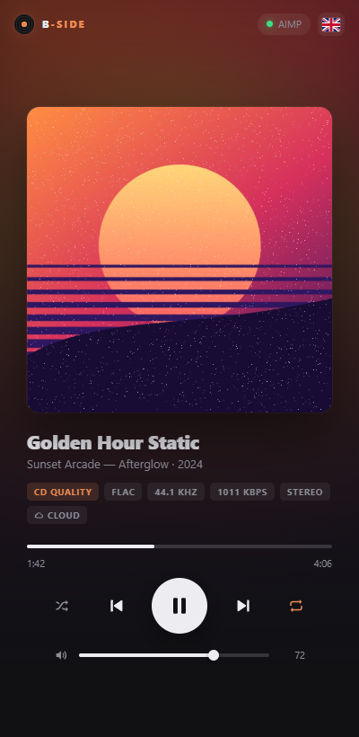

<p align="center">
  <a href="README.md"></a>&nbsp;<a href="README.md">English</a> &nbsp;·&nbsp;
  <a href="README.es.md"></a>&nbsp;<a href="README.es.md">Español</a> &nbsp;·&nbsp;
  <a href="README.de.md"></a>&nbsp;<a href="README.de.md">Deutsch</a> &nbsp;·&nbsp;
  <a href="README.ja.md"></a>&nbsp;<a href="README.ja.md">日本語</a> &nbsp;·&nbsp;
  <a href="README.zh.md"></a>&nbsp;<a href="README.zh.md"><b>中文</b></a> &nbsp;·&nbsp;
  <a href="README.ru.md"></a>&nbsp;<a href="README.ru.md">Русский</a>
</p>

<p align="center">
  
</p>

<p align="center">
  <a href="https://github.com/icaceresc/b-side/actions/workflows/ci.yml"></a>
  
  
  
  
  
</p>

# B-Side

在 Orca 里控制 AIMP：边工作边听你的无损收藏。[AIMP](https://www.aimp.ru) 通过内置的 **私有云**
（My Clouds）从云端（OneDrive、Google Drive、Dropbox 等）串流并播放音乐；B-Side 把播放器放进 Orca 的
侧边栏，切歌不必离开编辑器。

## 你能得到什么

<table>
  <tr>
    <td align="center"></td>
    <td align="center"></td>
    <td align="center"></td>
    <td align="center"></td>
  </tr>
  <tr>
    <td align="center"><sub>播放中</sub></td>
    <td align="center"><sub>等待中</sub></td>
    <td align="center"><sub>AIMP 已关闭</sub></td>
    <td align="center"><sub>离线</sub></td>
  </tr>
</table>

<p align="center"></p>

- **正在播放**：封面、标题、艺术家、专辑和年份。
- **封面配色**：面板用封面的配色生成背景和强调色，并保证文字在浅色和深色主题下都清晰可读。
- **歌词**：对磁盘上的文件，从文件的标签（FLAC 的 `LYRICS`/`UNSYNCEDLYRICS`、MP3 的 `USLT`/`SYLT`）或曲目旁的 `.lrc` 文件读取。同步歌词会高亮当前行。
- **艺术家图片**：对磁盘上的文件，显示艺术家文件夹里的 `artist.jpg`。
- **真实格式**：AIMP 报告的编码、采样率、比特率和声道；无损 44.1 kHz 立体声会显示 *CD 音质* 标记。
- **控制**：播放/暂停、上一首、下一首、拖动进度（拖动进度条或按 ←/→）、音量、静音（点扬声器图标；拖动滑块即取消静音）、随机和循环。`空格` 切换播放与暂停。
- **清楚的状态**：AIMP 已关闭（带 *Open AIMP* 按钮）、没有播放、AIMP 无响应、离线。
- **你的语言**：English、Español、Deutsch、日本語、中文 或 Русский，点角落的国旗即可切换。默认使用 Orca 的语言并记住你的选择；浅色和深色主题跟随 Orca。

*截图使用的是合成的演示曲目和封面。*

## 系统要求

- Windows 10 或 11
- [Git](https://git-scm.com/download/win)
- [Orca](https://github.com/stablyai/orca) 1.4.248 或更高版本
- Microsoft Store 版 AIMP（安装脚本会按当前用户为你安装，无需管理员权限）

## 安装

一共两步，都在 Orca 内的终端里运行（那里有 `orca` 命令）。

**1. 安装插件**

```powershell
orca plugin install icaceresc/b-side
```

B-Side 会在你的电脑上运行代码：一个由 Orca 启动、用来和 AIMP 通信的小 worker（*trusted worker*）。
所以第一次安装时 Orca 会先停下，列出插件将获得的权限（只有它自己的存储空间），并打印出末尾带
`--approve <代码>` 的同一条命令。运行这条命令即可批准并安装。

**2. 准备 AIMP**

```powershell
git clone https://github.com/icaceresc/b-side.git
cd b-side
powershell -ExecutionPolicy Bypass -File .\install.ps1
```

Windows 默认会阻止脚本，`-ExecutionPolicy Bypass` 只对这一次运行生效。`install.ps1` 会在缺少 AIMP
时安装它，修复 Store 版无法保存设置的问题，并在 My Clouds 中开启串流。它也会替你完成第 1 步：从
GitHub 安装或更新插件，并在 Orca 要求批准时打印批准命令，所以在新电脑上只运行这个脚本就够了。
脚本可以放心重复运行。选项：

- `-SkipSettings`: 安装 AIMP 并修复设置保存问题，但不改动 AIMP 的设置。
- `-SkipPlugin`: 只准备 AIMP，不安装插件。

然后在 Orca 右侧边栏打开 **B-Side**。

## 更新

```powershell
orca plugin update icaceresc.b-side
```

只有新版本申请更多权限时，Orca 才会再次请你批准。如果也想用最新的 `install.ps1`，在克隆的文件夹里
运行 `git pull`；再次运行脚本也会更新插件。

## 连接你的云盘（只需一次）

1. 在 B-Side 面板中点击 **Open AIMP**。
2. 在 AIMP 中打开 **私有云** 标签页，右键点击左栏的 **All**，选择 **添加存储**。
3. 服务：**OneDrive**（或其他）› **获取标记** › 登录 › 允许访问 › **OK**。
   如果电脑上有工作或学校账户，请先阅读[工作或学校电脑](#work-account)。
4. 选择一张专辑开始播放。之后就在 Orca 里控制它。


串流访问已开启，所以曲目不会被整首下载：AIMP 只缓冲正在播放的部分，并在退出时清空缓存。

<a id="two-ways-to-use-it"></a>

## 两种用法

**个人电脑：本地磁盘加云盘。** 把音乐放在本地磁盘上 AIMP 能播放的任意文件夹里（例如
`Music\Artist\Album\`），其余的从私有云串流。磁盘上的文件可以使用全部功能：歌词（标签里或
`.lrc`）、艺术家图片和封面配色。按下面的结构存放，B-Side 就能找到它需要的文件：

```text
Music\
  Artist\
    artist.jpg            艺术家图片
    Album\
      01 Title.flac
      01 Title.lrc        歌词，仅当文件标签里没有时才需要
```

**工作电脑：只用串流。** 所有音乐都从私有云（OneDrive）播放，你的音乐收藏不会复制到这台电脑上：
安装脚本会开启串流访问，AIMP 只缓冲正在播放的部分，并在退出时清空缓存。封面、标题、艺术家、专辑、
格式和封面配色都能正常显示；歌词和艺术家图片不行，因为对串流的曲目，AIMP 只给 B-Side 一个它无法
打开的 `cloud://` 地址，而 AIMP 的 Remote API 也不传递歌词。

<a id="work-account"></a>

> **⚠ 工作或学校电脑：请用你的个人账户登录私有云。**
>
> 如果 Windows 登录了工作或学校账户，**获取标记** 打开的 Microsoft 登录页面可能会自动选用该账户，
> 这样私有云就会从你的工作 OneDrive 串流。在 AIMP › **私有云** › **添加存储** › **OneDrive** ›
> **获取标记** 中，选择 **使用其他帐户**，用你的个人 Microsoft 账户登录；如果 Microsoft 询问账户类型，
> 选择 **个人帐户**。当 Windows 有工作或学校账户时，安装脚本会提醒你。
>
> - **检查**：在私有云中打开这个存储。你应该看到个人 OneDrive 的文件夹（你的音乐）。如果看到工作文件，
>   或一个陌生的空 OneDrive，说明用的是工作账户。
> - **修正**：右键点击该存储 › **编辑存储** › **获取标记**，用个人账户重新登录。或者右键 › **移除存储**
>   （勾选 **删除本地缓存** 可同时删除它的缓存文件），然后重新添加。

## 音质

B-Side 从不碰音频本身：解码和播放都由 AIMP 完成。安装脚本会关闭 AIMP 的音效（淡入淡出、
标准化、防削波和抖动）。增强效果由 AIMP 自己保存，请在它的音效窗口里检查。要让 CD 音质的文件不经重采样送到耳机，把设备在 Windows 中的格式设为相同的采样率：
**设置 › 系统 › 声音 › 你的设备 › 输出设置 › 格式：16 位，44100 Hz**。其他声音仍会和音乐一起播放。

想让 AIMP 独占设备？在 AIMP 的 **首选项 › 播放 › 设备** 中选择 *WASAPI Exclusive*。AIMP 播放时，该设备上的通知和通话将没有声音。

## 工作原理

```text
Orca 面板  ──plugin.request──▶  B-Side worker (Node)  ──stdin/stdout──▶  辅助程序 (PowerShell + C#)  ──AIMP Remote API──▶  AIMP
```

- 辅助程序只通过 AIMP 官方的 Remote API（窗口消息和共享内存 `AIMP2_RemoteInfo`）与 AIMP 通信。所有命令都在允许列表内。
- Orca 以 *trusted worker* 方式运行 worker：一个拥有你的用户账户在这台电脑上权限的 Node 进程，
  所以 Orca 会请你批准。在 Orca 自身的权限中，它只申请自己的存储空间，用来记住你的语言：不用终端、
  工作区或密钥。

## 隐私

- 读取 AIMP 报告的当前曲目信息：标题、艺术家、专辑、年份、格式和封面。当这首曲目是磁盘上的文件时，B-Side 还会以只读方式读取文件的标签、旁边的 `.lrc` 文件，以及专辑和艺术家文件夹中的图片文件，用来显示歌词和艺术家图片。对云端曲目，除了 AIMP 报告的内容，它什么都不读。
- 从不写入、移动或删除你的音乐文件。只保存你选择的语言（存在插件自己的 Orca 存储里），不发送任何东西。
- 从不触碰你的云盘账户或其登录。My Clouds 在 AIMP 内部登录。
- 不监听任何网络端口。面板可见时，每 30 秒打开并关闭一次到 `graph.microsoft.com:443` 的 TCP 连接来检查联网状态，不发送任何数据。
- 每次启动辅助程序时，Windows PowerShell 会在 `%TEMP%` 中编译它的一小段 C# 代码。

## 限制

- AIMP 的 Remote API 不提供播放列表和位深，所以 B-Side 不显示这两项。
- 针对 Microsoft Store 版 AIMP 4.60 开发和测试。AIMP 5 需要为整台电脑安装（需要管理员权限）。
- 仅支持本机的 Orca。
- 歌词和艺术家图片只适用于磁盘上的文件；串流的曲目显示封面、曲目信息和封面配色（[两种用法](#two-ways-to-use-it)）。
- 在有工作或学校账户的电脑上，私有云可能会用该账户登录：参见[工作或学校电脑](#work-account)。

## 恢复与卸载

- **AIMP 关闭后忘记了设置**：运行 `powershell -ExecutionPolicy Bypass -File .\install.ps1 -SkipSettings -SkipPlugin`。
- **AIMP 开着，面板却显示已关闭**：重启 AIMP，面板会自动重新连接。
- **撤销安装脚本对 AIMP 的修改**：AIMP 原来的设置保存在同一位置的 `AIMP.ini.b-side.bak`。
- **卸载**：运行 `orca plugin uninstall icaceresc.b-side`（如果是用 `-Dev` 加载的，运行
  `orca plugin dev unload <路径>\b-side`）；如不再需要 AIMP，在 Windows 设置 › 应用 中卸载它，然后删除克隆的文件夹。

## 开发

一切都在仓库根目录运行：

```powershell
orca plugin test .        # 单元测试 (node:test)
orca plugin validate .
orca plugin dev watch . --check --shot .orca/shots
powershell -ExecutionPolicy Bypass -File .\install.ps1 -Dev    # 加载这个文件夹，而不是 GitHub 上的版本
```

只有 `native/aimp-helper.ps1` 会接触 AIMP；worker 用 `powershell.exe -EncodedCommand` 启动它，
并通过 stdin/stdout 与它通信。GitHub Actions 会在 Windows 上运行 CI 工作流（见上方徽章）。

Orca 插件页面的图标、封面和截图由 `python docs/make-assets.py` 生成（需要 Pillow，以及 Chrome 或
Edge）：它用合成的演示曲目渲染真实的面板，所以面板有改动时请重新运行。

## 致谢与许可证

- B-Side：[MIT 许可证](LICENSE)。
- [AIMP](https://www.aimp.ru)（作者 Artem Izmaylov）和 My Clouds 是独立的产品，不包含在本仓库中。
  这是一个独立项目，不是 AIMP 或 Orca 的官方项目。
- 国旗图标：[lipis/flag-icons](https://github.com/lipis/flag-icons)，[MIT 许可证](panel/flags/LICENSE)。
