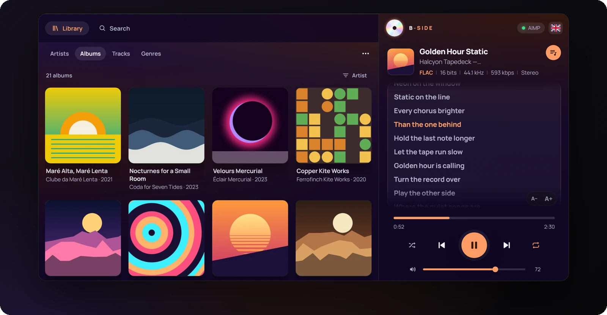
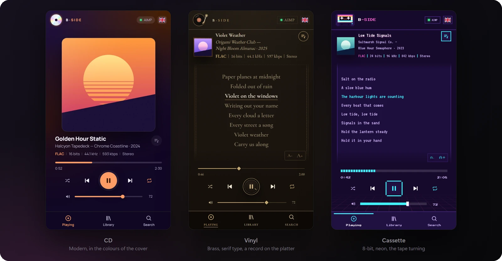

<p align="center">
  <a href="README.md">English</a> &nbsp;·&nbsp; <a href="README.es.md">Español</a> &nbsp;·&nbsp; <a href="README.de.md">Deutsch</a> &nbsp;·&nbsp; <a href="README.ja.md">日本語</a> &nbsp;·&nbsp; <b>中文</b> &nbsp;·&nbsp; <a href="README.ru.md">Русский</a>
</p>

<h1 align="center"><br>B-Side</h1>

<p align="center"><b>你的音乐库，就在 Orca 的侧边栏。</b><br>
浏览、搜索并播放 Windows 电脑上的音乐，带同步歌词和三套皮肤。<br>由免费播放器 AIMP 负责播放。</p>

<p align="center">
  
</p>

<p align="center">
  <a href="https://github.com/icaceresc/b-side/actions/workflows/ci.yml"></a>
  
  <a href="LICENSE"></a>
</p>

### 整个收藏，一键可达

来自你自己文件夹的艺术家、专辑、曲目和流派，带封面，以及从每个文件读取的格式（FLAC · 24&nbsp;位 · 96&nbsp;kHz）。按 `/` 或 `Ctrl+K` 输入即可搜索：输入 `rio` 就能找到 *Río*。

<p align="center"></p>

### 跟着歌曲走的歌词

同步歌词逐行亮起；用 A− 和 A+ 调整字号。歌词来自文件标签，或曲目旁边的 `.lrc` 文件。

### 三套皮肤，和一个跟着音乐动的标志

CD 披上每张封面的颜色，黑胶是皮革与古金色，磁带是像素风的 80 年代卡座。点一下标志即可选择皮肤；音乐播放时它会转动，暂停时停下。

<p align="center"></p>

### 本地、私密

B-Side 只读取你的音乐文件夹，从不改动你的文件。无需账号，没有跟踪：音乐在电脑上时，它唯一的联网用途是从 GitHub 下载一次它自己的 0.5&nbsp;MB 辅助程序，并用 SHA-256 校验；这一步也可以关闭。
[它读取、写入和下载什么](docs/guide.zh.md#privacy)。

## 安装

在 Orca 内的终端中运行：

```powershell
orca plugin install icaceresc/b-side
```

Orca 会列出 B-Side 可以做的事，并打印末尾带 `--approve <代码>` 的同一条命令：运行它。然后在右侧边栏打开**B-Side**，选择你的音乐文件夹。

**需要：** Windows 10 或 11、[Orca](https://github.com/stablyai/orca) 1.4.248 或更高版本，以及[Microsoft Store 中的 AIMP](https://apps.microsoft.com/detail/9PCLLLH15SMT)（免费）。还没有 AIMP？`install.ps1` 会帮你装好：[安装详情](docs/guide.zh.md#install)。

## 了解更多

[选择文件夹](docs/guide.zh.md#library-folders) ·
[全部功能](docs/guide.zh.md#features) ·
[故障排除](docs/guide.zh.md#troubleshooting) ·
[隐私](docs/guide.zh.md#privacy) ·
[更新](docs/guide.zh.md#update) ·
[从云端串流（测试版）](docs/guide.zh.md#two-ways-to-use-it) ·
[工作原理](docs/guide.zh.md#how-it-works) ·
[验证辅助程序](docs/guide.zh.md#verify-helper) ·
[开发](docs/guide.zh.md#develop)

---

<sub>[MIT](LICENSE)。独立项目，与 AIMP 和 Orca 均无关联。图片和演示音乐为 B-Side 专门制作：虚构的艺术家、原创合成音乐和生成的封面。[致谢](docs/guide.zh.md#credits)。</sub>
